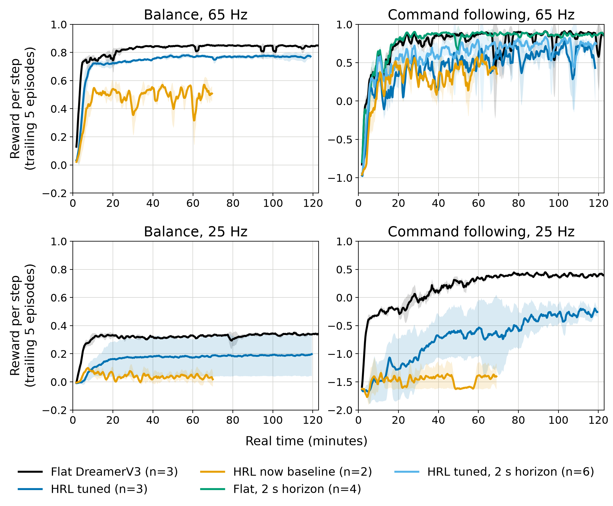
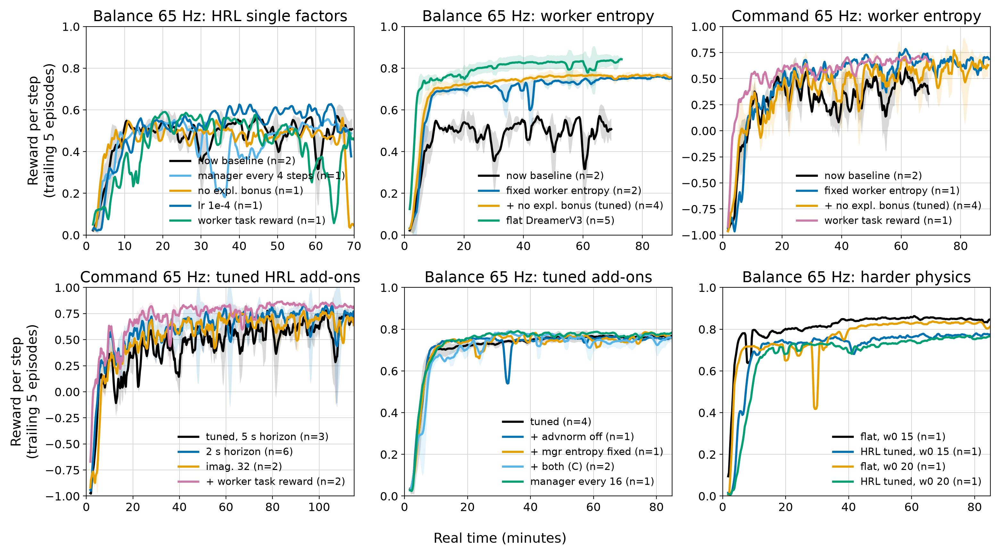

# The 'now' Director on the simulated phone robot (e1480–e1747, 2026-10-16/17)

## Summary

The question: how fast can the HRL agent (the 'now' Director: `director
director_og`, the late-collapse fix) learn the robot's two tasks in real time,
and which control rate should we deploy at, 25 Hz or 65 Hz?

- **Deploy at 65 Hz.** Every agent learns faster and better there. At 25 Hz
  the simulated body is barely controllable through the one-tick action delay;
  flat DreamerV3 tops out at 0.34 on balance, and HRL fails on 2 of 3 seeds.
- **The 'now' Director needs one real change for the robot**, and it is
  goal-only (the worker still gets only the goal reward): a fixed worker
  entropy. Config block `hrl_robot_fast` = `worker_actent_adapt False` +
  `mgr_expl_weight 0` (the second is neutral within seed noise; see below).
  Balance 0.50 → 0.77, command following 0.43 → 0.60.
- **Flat DreamerV3 is still ahead.** At 65 Hz, tuned HRL reaches 0.7 on
  balance in 6–10 min (flat: 5 min) and holds 0.77 against 0.84; on command
  following 0.60 against 0.82. A 2 s return horizon instead of 5 s narrows the
  command gap (HRL 0.71, n=6, against flat 0.87, n=4) but does not close it.
- **Giving the worker the task reward** (`wkr_extr_weight 1`, the fallback
  you'd rather not use) reaches 0.80 on command following (n=2): the
  goal-only HRL leaves ~0.1 on the table there.



Reward per step (episode score / steps, trailing 5 episodes) against minutes
of real time, mean ±1 std over seeds. 65 Hz runs on V100s, 25 Hz on P100s, one
GPU per run, 125 min. The 'now' baseline is from round 1 (70 min, one V100
and one P100 seed).

| 60–115 min mean | flat DreamerV3 | HRL tuned (`hrl_robot_fast`) | HRL 'now' (≤70 min) |
|---|---|---|---|
| balance, 65 Hz | 0.84, 0.84, 0.85 | 0.76, 0.77, 0.79 | 0.51, 0.48 |
| command, 65 Hz (5 s horizon) | 0.78, 0.88, 0.81 | 0.59, 0.67, 0.53 | 0.56, 0.30 |
| command, 65 Hz (2 s horizon) | 0.85, 0.88, 0.87, 0.87 | 0.81, 0.68, 0.68, 0.66, 0.70, 0.75 | – |
| balance, 25 Hz | 0.34, 0.32, 0.33 | 0.39, 0.08, 0.09 | 0.07, 0.01 |
| command, 25 Hz (5 s) | 0.41, 0.39, 0.38 | −0.27, −0.88, −0.17 | −1.5, −1.6 |
| command, 25 Hz (2 s) | 0.46, 0.44 | −0.24, −0.27 | – |

| minutes to hold 0.7 (trailing 5) | flat | HRL tuned |
|---|---|---|
| balance, 65 Hz | 5.0, 4.7, 4.7 | 6.0, 10.3, 9.7 |
| command, 65 Hz, 2 s | 16.0, 16.3, 9.7, 10.7 | 9.7, 21.7, 51.4, 23.7, 50.7, 23.4 |

## The simulator

`embodied/envs/robot_sim.py`, switched on with `env.robot.sim: True` (config
blocks `sim_robot` + `sim_25hz`/`sim_65hz`). It subclasses
`SmartphoneRobot` and replaces only the phone link, so observations,
actions, rewards, episode handling and every `robot_*` config block are the
real ones. One env, paced to wall clock by `env.realtime_hz`, through the
robot's actor/learner split.

The plant is a two-wheeled inverted pendulum in the phone's units and signs:
θ̈ = ω₀² sin(θ − θ_eq) − (a/L) cos θ − cθ̇, ω₀ = 12/s, L = 8 cm; bumper stops
at −6.9/+9.2° (inelastic); each wheel tracks its target speed with a 50 ms lag,
4900 mm/s at full output; one tick between an observation and the action it
prompts (the pipelined protocol); noise on tilt, rate and wheel speed; no
resets between episodes, as on the robot; θ_eq drawn per run within ±1°.

ω₀ is an estimate. The replay-based τ ≈ 50 ms (ω₀ ≈ 20) in
`ONDEVICE_POLICY.md` mixes in policy noise; at ω₀ 20 a tuned linear controller
cannot hold 25 Hz, while at 12 it holds 25 Hz loosely (tilt std ~2°) and 65 Hz
tightly (~0.3°). At 65 Hz the HRL–flat gap is the same at ω₀ 15 and 20
(e1724–e1727: HRL 0.76/0.76, flat 0.83/0.82), so the 65 Hz conclusions do not
hinge on it; the 25 Hz ones might.

## What changed the HRL agent, in order

1. **Fixed worker entropy** (`worker_actent_adapt False`). director_og adapts
   the worker's entropy toward a target of 0.5, which kept the worker's
   action entropy at about +0.2 nats against −1.8 for the flat policy. A
   worker that noisy cannot balance: balance 0.50 → 0.75 (e1512/e1516), and
   command following 0.43 → 0.67 (e1517).
2. **No manager exploration bonus** (`mgr_expl_weight 0`): neutral. It looked
   better early (command 0.65 vs 0.42 at 25 min) but not at 45–85 min
   (e1518 0.59 vs e1517 0.67, one seed each); balance 0.74 vs 0.75. Kept in
   `hrl_robot_fast` because the final round was run with it, and a dense-
   reward control task gives the novelty bonus nothing to find.
3. **2 s return horizon on command following** (130 steps at 65 Hz instead of
   `robot_command_lean`'s 5 s). HRL 0.60 → 0.71, flat 0.82 → 0.87. This
   contradicts the reason 5 s was chosen on the robot (time to lean before
   speeding up), so it is a sim result to try on hardware, not a default.

Tried and not kept (65 Hz, 1–2 seeds each, `docs/figs/sim_robot_sweep.png`):
manager every 4 or 16 steps, lr 1e-4, batch 16×64, advantage normalisation
off, fixed manager entropy, lower worker entropy (1e-4), worker sees the goal
code, 32-step imagination, 1024-wide goal autoencoder and manager (halves
learner throughput).



## Using it on the robot

```bash
HZ=65 CONFIGS="director director_og robot_daydreamer robot_fast robot_65hz \
  hrl_robot hrl_robot_fast" tools/robot_train.sh hrl_balance_65hz
HZ=65 CONFIGS="director director_og robot_daydreamer robot_fast robot_65hz \
  robot_command robot_command_lean hrl_robot hrl_robot_fast" \
  tools/robot_train.sh hrl_command_65hz [--agent.horizon 130]
```

The HRL policy acts from Saion (`env.robot.onboard False`, set automatically
for `hrl_robot`): the phone's numpy policy (`dreamerv3/deploy`) is the flat
actor only. On-device HRL needs the manager, goal decoder and worker exported
and run on the phone; not done.

## Runs

All archived in the bucket (`results/dreamerv3/e<N>_simrobot_*`); params files
`sbatch/sim_robot_*.txt`, launcher `sbatch/submit_sim_robot.sh`, tables and
figures `tools/plot_sim_robot.py`.

| exps | round | what |
|---|---|---|
| e1480–e1495 | R1 | flat vs 'now' HRL, 4 cells, 2 seeds, 70 min |
| e1496–e1511 | R2 | HRL single factors per cell (worker task reward, K 4, no expl., lr 1e-4) |
| e1512–e1520 | R3 | 65 Hz: fixed worker entropy, + no expl., K 16, batch 16 |
| e1521–e1526 | R4 | tuned at 25 Hz; + fixed manager entropy, + advnorm off |
| e1527–e1535 | R5 | 65 Hz add-ons (seeds, actent 1e-4, goal code, K 16) |
| e1700–e1723 | final | `hrl_robot_fast` vs flat, 4 cells, 3 seeds, 125 min |
| e1724–e1727 | R7 | balance 65 Hz at ω₀ 15 / 20 |
| e1728–e1735 | R8 | command 65 Hz: task reward ref, width 1024, imag 32, 2 s horizon |
| e1736–e1747 | R9 | 2 s horizon replicated (HRL n=6, flat n=4); 25 Hz command at 2 s |

e1496–e1499 and e1504–e1507 had one seed per arm; R2 jobs on saion-gpu06 and
a requeue on gpu04 were restarted under the same numbers. Caveats: one sim,
estimated physics, 1–6 seeds per arm; command-following curves are spiky
because the score depends on which commands an episode draws.
