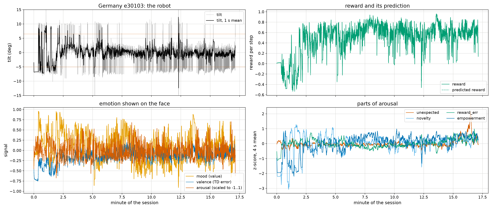
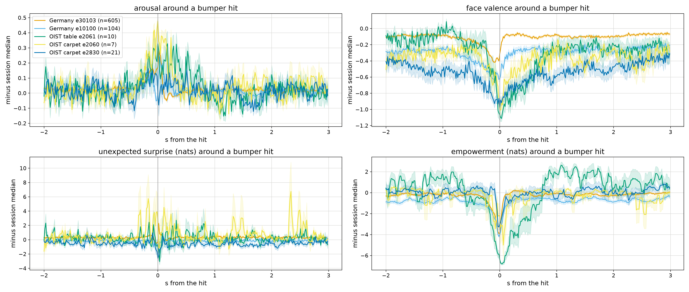

# Emotion: valence, arousal, dominance and pain from the world model

Started 2026-11-04 (Alex). The robot's affect is computed from quantities the
DreamerV3 agent already has, shown on a face, and used to steer learning,
both in imagination and on the real robot. Literature, with verified
citations: [EMOTION_LITERATURE.md](EMOTION_LITERATURE.md).

## Signals (dreamerv3/deploy/emotion.py)

Per control step, with q_t the posterior the observation gave and p_t the
prior the world model predicted (32 categorical latents x 4 classes here):

| signal | definition | reading |
|---|---|---|
| valence | TD error r_t + gamma V(s_t) - V(s_{t-1}), / running RMS, tanh | joy / distress, brief (Schultz 1997; Broekens 2015) |
| mood | z(V(s_t)) over ~1 min, tanh | hope / fear, slow; the dense balance reward keeps TD near 0 |
| surprise | KL(q_t ‖ p_t) | Bayesian surprise (Itti & Baldi 2009) |
| novelty | H(p_t) | how uncertain the prediction was |
| unexpected surprise | H(q_t) + KL - H(p_t) | surprise beyond the prediction's own spread (Yu & Dayan 2005) |
| reward error | abs(r_t - r_hat(s_t)) | |
| empowerment | 9 constant actions rolled 8 steps through the prior; mean KL of each end prediction from their mixture (= H(mix) - mean H) | control over where it ends up (Klyubin 2005) |
| helplessness | z(abs(TD)) x (1 - sigmoid(z(empowerment))) | large errors with no control (Maier & Seligman 2016) |
| **arousal** | sigmoid(z(novelty) + z(unexpected) + z(reward error) - z(empowerment) + helplessness) | |
| **dominance** | tanh(z(empowerment)) | PAD third axis |

The face shows `face_valence` = 0.7 mood + 0.3 valence, arousal and dominance.

## Where it runs

* Offline, on recorded runs: `tools/robot/dev/emotion_trace.py LOGDIR OUT.npz`
  (replays the observations and the applied actions through the policy; full
  checkpoints only, the published policy pickles lack the critic).
  Figures: `tools/robot/dev/fig_emotion_real.py`.
* On the phone: `PolicyRunner.feel(reward)` after each step (every 4 steps,
  empowerment on its own thread every 0.5 s), `emotion_state` in the web
  state, the face at `http://<phone>:8080/face` (`tools/robot/face/face.html`;
  app patch `tools/robot/dev/dreamerbridge_cap_home_face.patch`). Needs
  `--env.robot.weights_emotion True` so the pushes carry the prior, critic and
  reward head (~1 MB more as int8).

## First result: the signals read danger on the real robot

Five real live-training sessions (two in the Germany lab, one on the OIST
table, two on carpet), each traced with its final checkpoint:

Around every bumper hit (tilt crossing +6.5 / -5 deg) in all five sessions,
valence falls from ~0.3 s before the hit to its minimum at contact (-0.4 to
-1.1 below the session median), arousal peaks just before it, and
empowerment collapses at contact (-3 to -7 nats): against a bumper the
robot's actions stop mattering. Unexpected surprise is flat on average.

## Using it for learning

In imagination (agent.arousal_imag): each replay start's actor and critic
loss weighted by 1 + w clip(z(signal), 0, 3), renormalised per batch
(relative, because LaProp normalises any global scale). On real data:
surprise-prioritised replay (replay.fracs.priority, model-loss priority) and
a recency share standing in for a volatility-driven learning rate
(Behrens 2007; Nassar 2012). Experiments E1/E2 (e19340-e19360): carpet ->
table shift at 6 min, live balance recipe; results below when in.

Proposed next, on the real robot: arousal-set exploration noise on the phone
(Doya 2002: NE ~ inverse temperature), surprise-triggered weight pushes,
and a call for help on helplessness.

## Pain (proposed fourth axis; EMOTION_LITERATURE.md §8)

Pain = three parts, as in the nervous system: a hard barrier (the reflex:
our runaway brake, speed cap, fence and return home now; ATACOM, Liu,
Tateo, Bou-Ammar & Peters CoRL 2021 / T-RO 2025, as the smooth version on the
physical layer), a separate cost critic learned in imagination (fear,
anticipatory pain; its TD error = phasic pain and relief), and an affective
input (negative to valence, positive to arousal, damped by empowerment as
controllable pain is less aversive). Kept out of the task reward, so reward
cannot buy violations. Nociception = constraint proximity (tilt vs the
bumpers, wheel saturation, distance from home); intensity = violation +
size of the reflex's correction.
