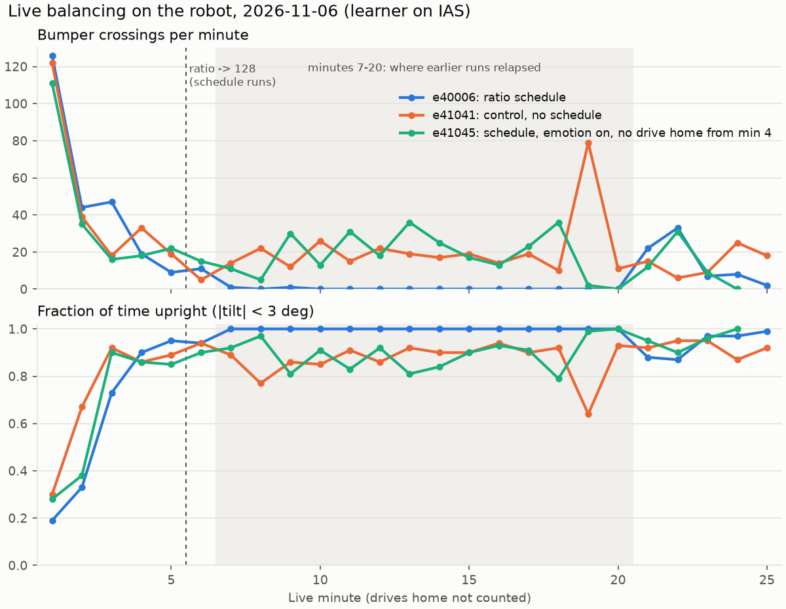
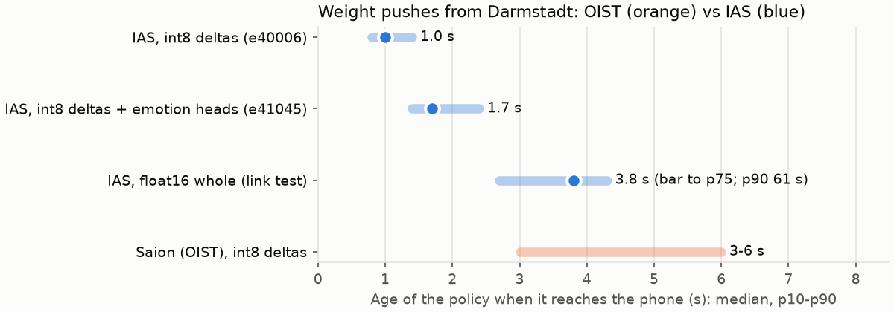
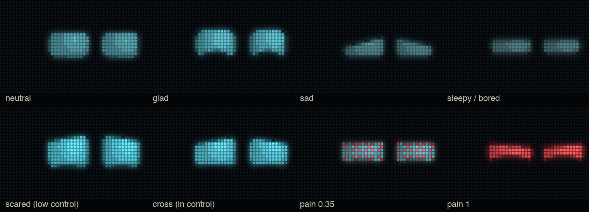
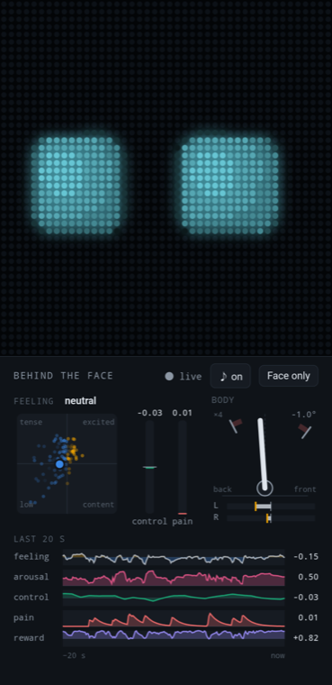

# Live session on the IAS cluster, Germany lab floor, 2026-11-06

## Summary

- **Late collapse: found a fix.** Every live run since e30102 balanced by
  minute ~5, then relapsed to 20-80 bumper crossings a minute. The cause is
  the learner's replay ratio: uncapped, it replays each robot step hundreds of
  times, over data that has become very similar once the robot balances.
  Dropping the ratio to 128 after 19,500 robot steps (`--online_ratio_switch
  19500 --online_ratio_late 128`) held e40006 at 0-1 crossings a minute from
  minute 7 to 20. The matched control without it (e41041) relapsed at
  minute 7, as before. n = 1 each, and a capped ratio trades away
  compute-scaled learning, so we are still after a fix that targets the root
  cause.
- **Speed: balancing in about 10 minutes.** From launch: phone connected at
  ~2 min, upright 90% of the time at ~6 min, steady at ~9.5 min (live
  minute 7). Still slower than we want.
- **IAS cluster (TU Darmstadt) connected.** Up to 10 more GPUs; jobs start in
  seconds (`--qos=debug`); policies reach the phone 1.0 s after they are made
  instead of 3-6 s from OIST; `ROBOT_PROFILE=ias tools/robot/train.sh`.
  Saion and IAS can reach each other over ssh.
- **Face reworked, grounded in two literature reviews.**
  [FACE_LIT_ROBOTS.md](FACE_LIT_ROBOTS.md) (Cozmo/Vector source, WALL-E/EVE,
  Reachy Mini, Disney BDX, Kismet, Kalegina et al. 2018): eyes only, no mouth,
  brows or pupils; one hue; constant small life (blinks, darts).
  [FACE_LIT_AFFECT.md](FACE_LIT_AFFECT.md) (facial EMG, pupil, gaze, posture,
  grimace scales): which channel carries valence, arousal, dominance and pain,
  and on what timescale (reflex ~50 ms, expression ~0.3 s, posture seconds,
  mood minutes). Sound: babble driven by arousal, valence and dominance, plus
  event sounds in step with the face. Pain now works on the phone.
- **Open issue.** With emotions on, the phone's control loop fell to ~47-55 Hz
  (from 65); e41045, the schedule rerun with emotions on and no drive home,
  did not hold like e40006. Fix pushed (empowerment computed in slices every
  3 s, web state at 30 Hz), not yet measured on the robot.





The new face, rendered from `tools/robot/face/face.html`: one hue, eyes
only; pain squints the same eyes and turns them red LED by LED.



The phone during training (e41045): the face, and "behind the face" the
feeling map, control and pain gauges, the body's tilt, and 20 s traces.



## Details

First robot runs with the learner on the TU Darmstadt IAS cluster
(`ROBOT_PROFILE=ias`, tools/robot/robot.ias.env, gitignored) instead of Saion.
Recipe: e30114 + the replay-ratio schedule from 670b0b1. Code:
`smartphone-robot-bridge` 670b0b1..6173061.

## IAS as the learner host

Measured the same day, phone and Mac on the Darmstadt WiFi:

| | IAS | Saion (from Germany) |
|---|---|---|
| ssh login | 0.01-0.3 s | 4-8 s (jump host) |
| submit -> job running | 2-3 s (`--qos=debug`) | instant when free; today blocked by the sim sweep (AssocGrpGRES) |
| submit -> phone connected | ~1:50 (compile) | ~5 min to first policy (earlier runs) |
| policy age at install | p50 1.0-1.7 s | 3-6 s |
| learner, uncapped | ~37k samples/s (A5000) | ~27k (V100, ~420 replays per step) |

Compute nodes are firewalled from the WiFi, so the Mac relay is still needed
(~5 ms to the login node instead of ~310 ms). int8 delta pushes stay: float16
was slower (2.7 MB per push, age 2.3-3.6 s). The learner uses ~1-1.5 cores and
4.4 GB, so trainer_job.sh now asks for 4 cores / 16 GB (6173061).

## Runs

| run | what changed | outcome |
|---|---|---|
| e40001 | e30114 recipe + `--online_ratio_switch 19500 --online_ratio_late 128` + `--run.train_ratio 420` | learner died at ~2 min: actor_step read during os.replace on BeeGFS (fixed, df04a0c) |
| e40002 | same, with the fix | stalled: a 420 cap idles the learner while the robot drives home between the short early episodes, so weights came out every 30-90 s. The V100's ~420 was an average, not a limit -- do not cap |
| e40003 | no cap | some drives home sat still for the full `home_max_s` 30 s: at `home_speed 0.5`, `home_ramp 3000` the command near home is ~0.3, too weak to move the robot here |
| e40004 | + `home_speed 1.0 home_ramp 1200 home_max_s 10` | stopped after 4 min to drop the emotion heads |
| **e40006** | + `weights_emotion False`, `--online_publish_every 1` | **held 13 min after the switch**, see below |

e40005 never started (`online_publish_every` takes whole seconds; 0.5 was rejected).

e40006's full command:

```
ROBOT_PROFILE=ias DEMO=1 tools/robot/train.sh demo_ratio_sched --online_publish_every 1 \
  --env.robot.weights_emotion False --env.robot.home_radius 3045 --env.robot.home_speed 1.0 \
  --env.robot.home_ramp 1200 --env.robot.home_max_s 10 --env.robot.balance_bumper 1.0 \
  --env.robot.wheel_penalty 0.5 --env.robot.pos_tau 1.0 --env.robot.pos_penalty 1.0 \
  --env.robot.pos_range 3000 --env.robot.drive_cap0 0 --online_ratio_switch 19500 --online_ratio_late 128
```

## e40006 s01, minute by minute (tools/robot/dev/demo_stats.py)

Switch to ratio 128 logged at actor step 19,500, ~5.5 live minutes in.
Policy age at install p50 1.0 s, p90 1.4 s (1006 pushes).

| min | upright | crossings/min | wobble deg/s | \|speed\| mm/s | reward |
|---|---|---|---|---|---|
| 1 | 0.19 | 126 | 45.5 | 1371 | -0.95 |
| 2 | 0.33 | 44 | 26.1 | 1617 | -0.96 |
| 3 | 0.73 | 47 | 27.6 | 731 | 0.29 |
| 4 | 0.90 | 19 | 17.7 | 530 | 0.47 |
| 5 | 0.95 | 9 | 12.5 | 266 | 0.71 |
| 6 | 0.94 | 11 | 16.3 | 346 | 0.65 |
| 7 | 1.00 | 1 | 6.4 | 150 | 0.85 |
| 8 | 1.00 | 0 | 1.0 | 25 | 0.93 |
| 9 | 1.00 | 1 | 7.2 | 137 | 0.83 |
| 10-20 | 1.00 | 0 | 1.4-1.8 | 11-26 | 0.88-0.95 |
| 21 | 0.88 | 22 | 17.9 | 198 | 0.70 |
| 22 | 0.87 | 33 | 26.0 | 416 | 0.53 |
| 23 | 0.97 | 7 | 16.0 | 299 | 0.73 |
| 24 | 0.97 | 8 | 17.1 | 287 | 0.74 |
| 25 | 0.99 | 2 | 7.2 | 71 | 0.85 |

The session ended at its 100k-step limit. A repeat (s02, same job) was stopped
after ~2 min by Alex.

## Reading

- The longest hold of any live run: 0-1 crossings a minute from minute 7 to 20,
  where every run since e30102 had climbed back to 20-80 after minute 7.
- Not a full cure: a two-minute relapse at minutes 21-22 (22, 33 crossings),
  which recovered by itself by minute 25.
- From minute 10 the robot stands almost still (11-26 mm/s). Whether it still
  catches pushes or moves when asked was not tested.
- n = 1, and it differs from e30114 in more than the schedule: IAS learner
  (~1.4x the V100 before the switch), no emotion heads, weights every 1 s, a
  full-speed drive home capped at 10 s. Attributing the hold to the schedule
  needs the control below.

## Control: e41041, the same command without the schedule

`--online_ratio_switch 0`, otherwise e40006's flags (plus `--run.log_every 2
--run.save_every_steps 3900`, which do not change learning). RTX 6000 Ada.
Per-minute snapshots in `ckpt_milestones/` (33 MB each).

| min | upright | crossings/min | wobble deg/s | \|speed\| mm/s |
|---|---|---|---|---|
| 1-6 | 0.30 -> 0.94 | 122 -> 5 | 53 -> 22 | 1492 -> 615 |
| 7-12 | 0.77-0.91 | 12-26 | 24-30 | 553-915 |
| 13-18 | 0.90-0.94 | 10-19 | 17-25 | 368-443 |
| 19 | 0.64 | 79 | 41.9 | 717 |
| 20-25 | 0.87-0.95 | 6-25 | 17-26 | 350-564 |

Learned as fast as e40006 (better at minute 3), then never settled: 10-26
crossings a minute from minute 7, where e40006 held 0-1. The schedule is the
only difference, so it is what held e40006 (n = 1 each).

## Saved policies on the phone

`e40006_balance_min25` (the final weights, right after the relapse) fell over in
the player. Two bugs fixed on the way: `save_policy.sh` wrote `length: 0`, so
the player reset the policy's memory every step (bfcf344; its actions matched
a per-step reset to 0.007); sampling instead of the mean did not help. The
battery read 3.66 V.

Per-minute snapshots of the control (`--run.save_every_steps 3900`, exported
with `POLICY_PKL=... save_policy.sh`, eb94a63) do balance frozen, about as well
as in training at that minute (player, eval actions, ~30 s each):

| snapshot | upright | crossings/min | \|speed\| mm/s | training at that minute |
|---|---|---|---|---|
| e41041_min6 | 0.86 | 6 | 926 | 0.94 / 5 |
| e41041_min22 | 0.87 | 21 | 596 | 0.95 / 6 |

So a saved policy works once the episode length is right; pick snapshots from
steady minutes. e40006's quiet minutes 7-20 were not kept (no snapshots then).

## Best method so far

e40006's command (above): e30114's recipe + the replay-ratio schedule
(`--online_ratio_switch 19500 --online_ratio_late 128`), `weights_emotion
False`, `--online_publish_every 1`, full-speed drive home capped at 10 s,
learner on IAS (uncapped). Add `--run.save_every_steps 3900` to keep a
snapshot per live minute.

Time to stability (e40006; a live minute is ~1.07 wall minutes, the drives home
are not counted):

| milestone | live min | wall clock from launch |
|---|---|---|
| phone connected | 0 | ~2 min (queue 3 s, compile) |
| upright >= 0.90 | 4 | ~6 min |
| ratio switch to 128 | 5.5 | ~8 min |
| upright 1.00, <= 1 crossing/min | 7 | ~9.5 min |
| held (0-1/min, wobble ~1.5 deg/s) | 7-20 | to ~23 min |

Caveats: n = 1 with the schedule; a two-minute relapse at minutes 21-22.

## e41045: schedule rerun with emotions on, no drive home from minute 4

e40006's command plus `--env.robot.weights_emotion True` (face reacts to
emotion), `--env.robot.home_off_steps 15600` (new, c10d3cb) and per-minute
snapshots. Upright 0.90 by minute 3, but 13-36 crossings a minute at minutes
9-18, like the control. Not a clean repeat: the phone's loop ran at ~47-55 Hz
(the emotion code), policy age 1.7 s (vs 1.0), an app restart at ~minute 9
to enable pain, and a ~5 min outage near the end (a stray adb swipe closed the
app; the reconnect counted as a restart and ended the session early).

## Next

1. ~~Control~~ done (e41041): relapsed, so the schedule matters.
2. Check the phone loop holds 65 Hz with emotions on (the fix above), then
   repeat e40006 for n = 2, past 25 minutes, with snapshots.
3. Then movement: push tests or `robot_command` with the schedule.
4. ~~Frozen snapshots~~: they balance (e41041 min 6, min 22).
5. Keep IAS sims off `--qos=debug`: two sim jobs there blocked the live run for 8 min.
