# Command following, still balance and floor changes, in the fitted sim

Weekend of 2026-10-24/25. Everything here is the MuJoCo sim
(`embodied/envs/robot_mujoco.py`, `--configs robot [robot_command] robot_sim`),
65 Hz, paced to real time, flat DreamerV3. Experiments e2070–e2424 (main
repo `EXPERIMENTS.md`), launchers `sbatch/sim_*.txt`, figures in
`figs/weekend/`, videos in `/work/DoyaU/vasilache/work/realcmd/videos/`
(copy in the bucket, `results/robot_weekend_20261024/`; runs archived to
`results/dreamerv3/`, with their experience). Tables are mean ± std over seeds; n in each row.

## For Monday 11-02 (round 6, §11)

Sim policies to try (`tools/robot/from_sim.sh try <name> <run dir> <step>`,
run dirs under `/work/DoyaU/vasilache/work/`):

| name | run dir | step | for |
|---|---|---|---|
| r6_carpet | e8167_simrobot_command65_flat_20261030_233514_eiGqqg | 916500 | carpet only |
| r6_mixed | e8217_simrobot_command65_flat_20261031_071633_sNSoGP | 799500 | carpet and table |
| r6_mixed_s | e8214_simrobot_command65_flat_20261031_071633_FbmAx5 | 799500 | carpet and table (second spatial run) |
| r6_mixed_fri | e8164_simrobot_command65_flat_20261030_233513_WNSm4b | 877500 | carpet and table (Friday-night pick, no spatial term) |
| r6_mixed_b | e8136_simrobot_command65_flat_20261030_170717_sjT872 | 643500 | carpet and table (backup) |
| r6_carpet_b | e8132_simrobot_command65_flat_20261030_170714_wSS4ze | 643500 | carpet only (backup) |

Do not put a carpet-only policy on the table: in sim it runs away there.
Rounds 6i-6k (lower learning rates, sensor-lag randomisation, 6-h runs) did
not beat these picks (§11.3). Round 6l (CAPS spatial smoothing) gave the new
mixed pick: same tracking as e8164, fewer falls, steadier across checkpoints
(§11.3, §11.4). Rounds 6m/6n (lag randomisation, with and without the
spatial term) finish Saturday afternoon; this table is updated if they win.

## For Monday 10-26 (weekend)

1. **Command following, from scratch on the robot:**
   `CONFIGS="robot robot_command" tools/robot/train.sh cmd`. The block now
   has a 2 s horizon (was 5), no friction compensation (was on) and full
   stick = 2500 mm/s (was 4900). Give it **40–60 min**. In the sim it tracks
   turns after ~10 min, forward on the table after ~10 and on carpet after
   ~20–30 (see 2). Judge it by `epstats/log/cmd_forward` against
   `epstats/log/forward` (or `tools/robot/dev/plot_cmd_tracking.py` on the
   run), not by the reward.
2. **Balance still on the table:** the `robot` block's `wheel_penalty` is now
   1.5 (was 0.3; e2078 used 0.6). No other change needed (see 3).
   The `robot` block also keeps all experience now (`replay.size` 1e6, was
   1e5): with the old 26-min buffer a policy that had stood still for half
   an hour forgot how to get off a bumper (see 5).
3. **Carpet → table:** the sim does not reproduce "never re-learns" with the
   floors as fitted; with a carpet that holds the wheels (as the real one
   does) it re-learns ~1.5x slower than a fresh run, and none of weight
   decay, L2-init or a bigger replay fixes that (see 4). The forgetting
   half (back on carpet it is worse) matches replay eviction: with the old
   buffer the sim falls again during a second carpet visit, with 1e6 not
   (see 5, 6). What would tell us
   most is one real run with the floor written down: carpet ~10 min, table
   ~20 min, carpet ~10 min, `wheel_penalty` 1.5.
4. **Videos** (sim, 32 s each, side by side): `final_cmd_carpet_10_vs_75min`,
   `final_cmd_table_10_vs_75min` (final recipe, refitted floors),
   `final_switch_carpet_to_table`, `still_table_wp03_vs_wp15`; older fit2-floor
   ones: `cmd_carpet_10_vs_60min`, `cmd_table_10_vs_60min`,
   `cmd_carpet_vs_table_60min`, `switch_carpet_policy_on_table`.

## 1. The sim against the robot

**fit2** (the Friday handoff's job) cut the probe error from 0.93 to 0.74. To
check the sim where it matters -- balancing -- `tools/robot/dev/replay_to_sysid.py`
turns a training run's experience into a probe-style recording, and
`sysid_fit.py --phases balance` scores 0.3 s open-loop windows of it.
Held out (e2060 s02 carpet, e2061 s02 table), window error:

| floors | carpet | table |
|---|---|---|
| fit1 | 2.41 | 4.69 |
| fit2 | 2.21 | 3.90 |
| fit3 (motor + floors on probe + balancing) | 2.01 | 3.53 |
| **final** (fit2 motor; carpet fit6, table fit5) | **2.00** | **3.74** |

fit3 fits best but drops the gearbox's stiction (stick 0.38 → 0.004), which
the stand tests contradict (a still wheel does nothing below ~0.3 output), so
the motor stays fit2's. fit5/fit6 add **rolling stiction** per floor (a still
wheel takes `stiction` x the rolling resistance to start, with MuJoCo's
no-slip solver so the static part does not creep). Fitted, the carpet's is
4.5x: the sim carpet now holds a 2–5 deg lean and stops a kicked robot at
1–2 deg, as the real one does, where fit2's tipped over to a bumper
(`figs/weekend/fit2_final_kicks.png`, left column). The table's is
negligible. Known misses: the carpet holds the body on its front bumper a
little too long in PRBS tests, and the table (soft contact, fit5) rests at
+7.7 deg on the front bumper, not the measured +9.2.

Qualitatively the fitted sim also reproduces the real floors: trained on the
table with the old `wheel_penalty` 0.3 it balances while **pivoting on one
wheel** (one at ~3500 mm/s, the other ~40), as e2061 and e2078 did; on
carpet it stands nearly still. It balances on carpet in ~2 min and on the
table in ~5 (real: ~2–3 and ~3–4).

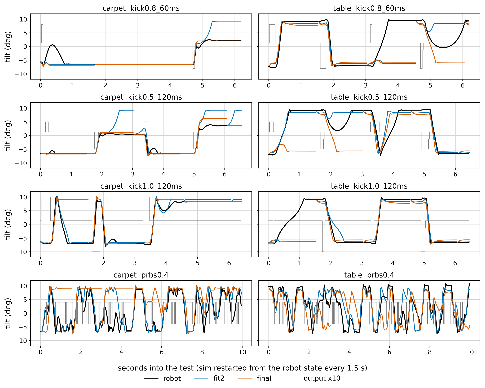

## 2. Command following

**Why it never trained on the robot.** The Oct 15 runs (the only real
command runs) learned to turn (corr up to 0.8) but barely to drive (forward
gain 0.04–0.32 after 25–31 min) -- `figs/weekend/real_cmd_oct15.png`. They
ran on the stack of that week: 50 Hz, no chatter penalty, a balance that was
itself poor (tilt std ~3 deg against ~0.5 now), and 25–30 min each. In the
sim the same recipe learns both axes, but forward on carpet is slow and only
reaches about half the commanded speed; with rolling stiction (the real
carpet) forward gain after 25–30 min is ~0.3–0.5 -- not far from what the
robot showed. So the robot most likely was on its way and stopped early, on a
carpet that makes forward driving the hard part. What changed:

| change | evidence (sim) |
|---|---|
| horizon 5 → 2 s | carpet: min to forward corr 0.7, 28.5 ± 8.6 (4/5 seeds) → 18.2 ± 1.3 (5/5); table 11.8 ± 2.8 → 10.8 ± 2.7 (n=5) |
| friction_comp on → off | table and carpet as good or better; on the stiction carpet it slowed forward (30.2 ± 8.0 vs 17.8 ± 6.4 min, n=3–4) |
| full stick 4900 → 2500 mm/s | stiction carpet: forward gain 0.58 ± 0.05 → 0.75 ± 0.06 after an hour (n=3–4); table gain unchanged (~0.9) |
| tried, not taken | command_sigma 0.6 (forward no faster, one late collapse), hold 2–4 s, ramp 1.0, product reward (stays on a bumper) |

Final recipe on the refitted floors: see the table in section 5 (filled in
from the final validation).

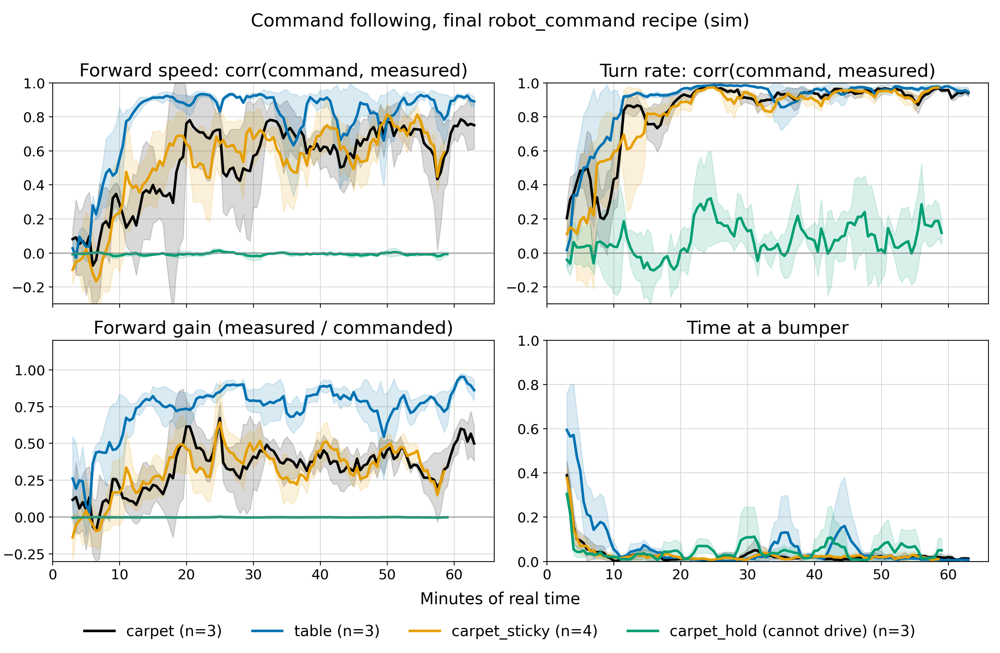

## 3. Balance still on the table

The balance reward's wheel cost is `wheel_penalty * mean_w min(|v_w| * 1e-4, 1)`:
at 0.3 a pivot at ~3000 mm/s costs ~0.05 of a reward near 0.85, so it pays to
pivot. Sim, table, last 3 minutes of 33:

| reward | n | min to balance | median \|wheel\| (mm/s) | tilt std (deg) |
|---|---|---|---|---|
| wheel_penalty 0.3 (old) | 2 | 5.2 ± 1.0 | 2662 ± 596 | 0.60 ± 0.26 |
| wheel_penalty 1.0 | 3 | 5.7 ± 0.4 | 111 ± 60 | 1.44 ± 0.10 |
| **wheel_penalty 1.5** | 5 | 6.3 ± 1.5 | **59 ± 14** | 1.40 ± 0.26 |
| wheel_penalty 2.0 | 3 | 8.2 ± 2.8 | 72 ± 23 | 1.54 ± 0.28 |
| still_speed 2000 (new, multiplicative) | 5 | 7.7 ± 0.8 | 212 ± 334 | 1.82 ± 0.87 |
| still_speed 3000 | 3 | 6.6 ± 1.0 | 47 ± 8 | 1.13 ± 0.81 |

On carpet `wheel_penalty` 1.5 costs ~0.6 min (2.4 ± 0.3 vs 1.8 ± 0.2 to
balance, n=3/2). `still_speed` (a factor exp(-|v|/still_speed) on the upright
score, `robot.py`) is stiller per seed but one in five collapsed back onto a
bumper; 0.6, as in e2078, only halves the pivot in the sim, as it did on
the robot. Video: `still_table_wp03_vs_wp15.mp4`.

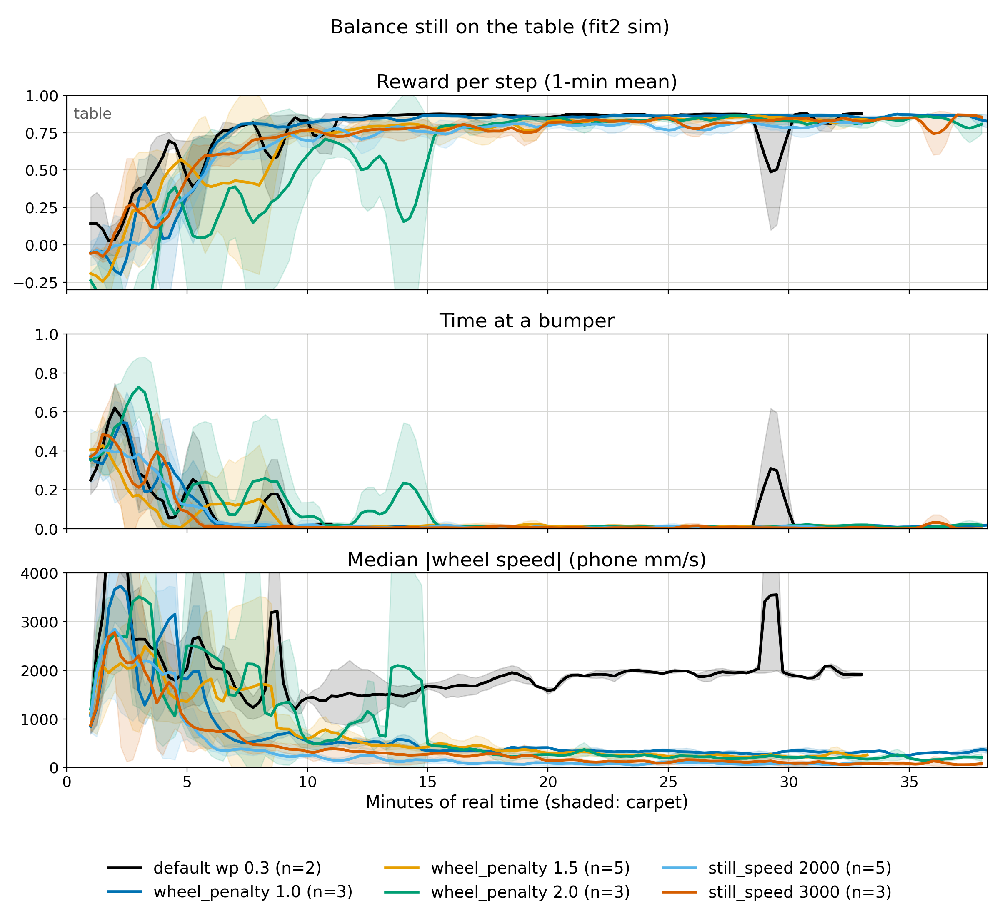

## 4. Moving it from carpet to the table

`env.robot.sim_schedule 'carpet:15,table:20,carpet'` moves the sim robot
mid-run (set down on a bumper; `sim_carry_s` also carries it in the air,
which made no difference). Minutes until the 1-min reward holds 0.6 again:

| | n | table after carpet | fresh table | back on carpet |
|---|---|---|---|---|
| fitted carpet (fit2), baseline | 6 | 4.4 ± 0.8 | 5.2 ± 1.0 | 1.2 |
| + weight decay 1e-1 | 6 | 5.3 ± 1.3 | | 1.2 |
| + L2-init 3e-1 (decay toward the initial weights, new `opt.wdinit`) | 6 | 5.2 ± 0.9 | | 1.2 |
| + replay 1e6 (nothing evicted) | 6 | 4.6 ± 0.8 | | 1.2 |
| carpet_hold (holds a lean; too stiff to drive), baseline | 6 | 7.0 ± 2.7 | 4.5 ± 1.6 (n=7) | 1.2–1.8 |
| + weight decay 1e-1 | 5 | 6.9 ± 2.6 (4/5) | | 1.2 |
| + L2-init 3e-1 | 5 | 6.2 ± 0.8 (4/5) | | 1.2 |
| + replay 1e6 | 5 | 7.3 ± 1.6 | | 1.2 |
| carpet_sticky (hand-set stiction 2.5x), baseline | 5 | 6.5 ± 2.2 | | 1.2 |
| fit6 carpet (stiction), baseline | 5 | (section 5) | | |

What the sim shows: right after the move the carpet policy saturates the
wheels for several minutes (`switch_carpet_policy_on_table.mp4`); the
fitted-carpet agent then re-learns as fast as a fresh one, and an agent that
learnt on a carpet that holds it up (carpet_hold, carpet_sticky) takes
~1.5x as long. Nothing is
forgotten: back on carpet it holds within ~1 min, and alternating every 10
min the second table visit takes 1.2 min (n=3). Earlier, smaller rounds (n=3)
had suggested weight decay and a big buffer halve the re-learning time; with
6 fresh seeds that disappears, so I would not change the recipe for this.
Literature notes (plasticity loss, MBRL continual learning) are in
`/work/DoyaU/vasilache/work/realcmd/continual_lit.md`.

What the sim cannot show is why the robot "never" re-learns. Candidates it
leaves out: the user handling the robot while it races off after the move;
a real table policy that pivots and drives off the edge; anything that
degrades over a long session (none seen in the logs, but no logged session
is longer than ~12 min). The cheapest way to find out is one labelled real
run (For Monday, 3).

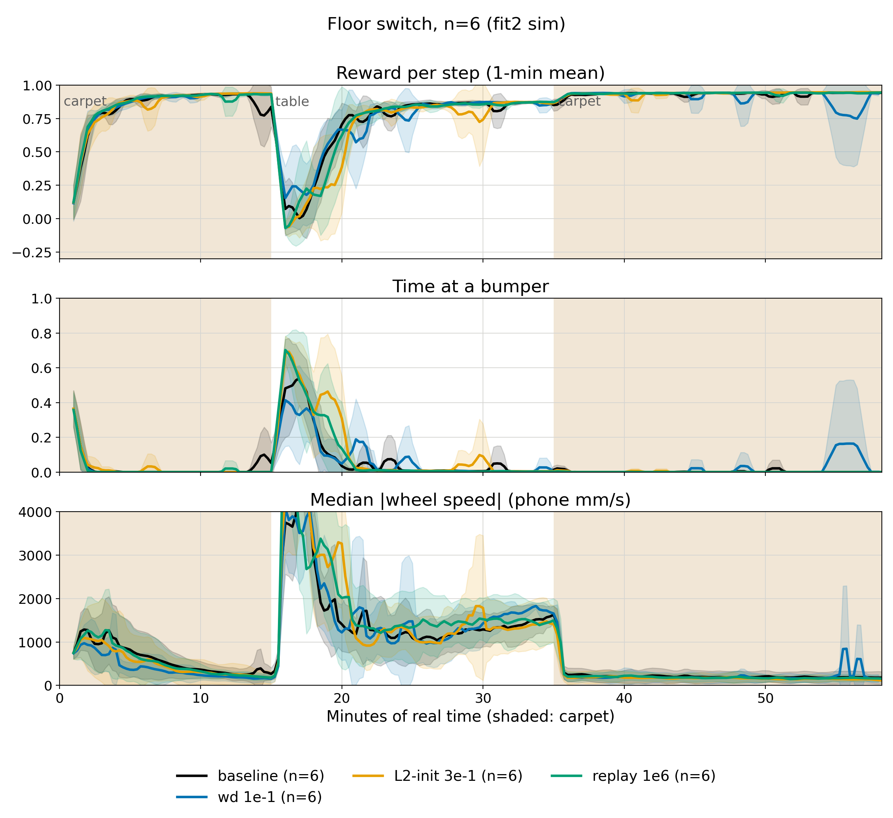

## 5. Late collapse, and keeping all experience

On the refitted carpet (with stiction) the balance policy ends up standing
perfectly still -- wheels at the sensor-noise floor, outputs inside the
stiction band -- and then, 25–55 min in, creeps over and falls onto the front
bumper, where it stays for minutes (e2370–e2372: 3/3 seeds). By then the
26-minute FIFO replay (1e5 steps) holds no example of getting off a bumper.
Keeping all experience (`replay.size 1e6`, `online_actor_replay_size 1e6`)
removes it:

| replay | n | seeds that fell after min 10 | bumper-minutes after min 10 |
|---|---|---|---|
| 1e5 FIFO (old) | 8 | 8 | 3.1 ± 2.8 |
| 1e6 (new default) | 8 | 1 (0.3 min) | 0.04 ± 0.1 |
| 1e5 with wheel_penalty 0.3 | 2 | 2 | 4.1 ± 0.5 |
| 1e6 + recency 0.5 | 4 | 1 (0.1 min) | 0.03 ± 0.04 |

80–100 min runs, e2381–e2398, e2421–e2424. This is the forgetting half of "back on
carpet it does not balance as before": any session longer than ~26 min on
one floor evicts the other floor's experience with the old buffer. 1e6
steps is 4.3 h at 65 Hz, ~3.8 GB of RAM per hour of experience. The cost:
command following on carpet may learn turns more slowly with all experience
kept (17.6 ± 3.2 vs 8.5 ± 5.3 min, n=4); forward and the table are within
noise (table below). Drawing half of each batch from recent experience
(`replay.fracs` uniform 0.5, recency 0.5) on top of 1e6 does not bring the
speed back: forward corr 0.7 at 32.2 ± 9.5 min, turn 15.1 ± 2.9 (n=4,
e2417–e2420; `figs/weekend/sim_cmd_recency.png`), so the block keeps uniform
sampling.

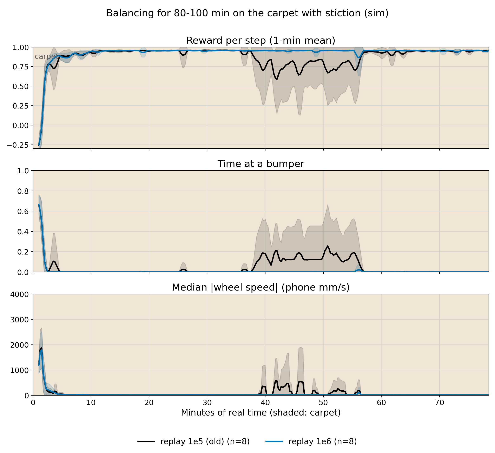

## 6. Final validation (refitted floors, final blocks)

`robot robot_command robot_sim` and `robot robot_sim` as committed, floor
and seed only. Minutes to correlation 0.7 between command and measured
speed, and the last ~2 min:

| floor | replay | n | forward (min) | turn (min) | forward gain (late) |
|---|---|---|---|---|---|
| table (fit5) | 1e5 | 4 | 10.4 ± 2.2 | 8.9 ± 1.4 | 0.94 ± 0.03 |
| table (fit5) | 1e6 | 4 | 11.6 ± 2.3 | 8.6 ± 4.0 | 0.98 ± 0.04 |
| carpet (fit6, stiction) | 1e5 | 4 | 29.4 ± 11.3 | 8.5 ± 5.3 | 0.71 ± 0.17 |
| carpet (fit6, stiction) | 1e6 | 4 | 36.4 ± 15.1 | 17.6 ± 3.2 | 0.66 ± 0.07 |

Balance (`robot`, wheel_penalty 1.5): carpet 2.3 ± 0.2 min, table
5.5 ± 0.2 min to hold 0.6 (n=3).

Carpet 15 min → table 30 min → carpet 55 min on the refitted floors
(e2405–e2412, n=4 each), old and new replay:

| replay | table after carpet (min) | back on carpet (min) | bumper-minutes on the 2nd carpet visit |
|---|---|---|---|
| 1e5 FIFO (old) | 6.6 ± 0.7 | 1.2 | 0.89 ± 0.94 |
| 1e6 (new) | 5.7 ± 1.5 | 1.2 | 0.00 ± 0.00 |

Both hold the carpet again within ~1 min of the move back. With the old
buffer, though, the robot falls again 15–50 min into the second carpet
visit; with 1e6 it does not (`figs/weekend/floor_switch_final.png`). That
is the closest the sim gets to "back on carpet it no longer balances as
before".

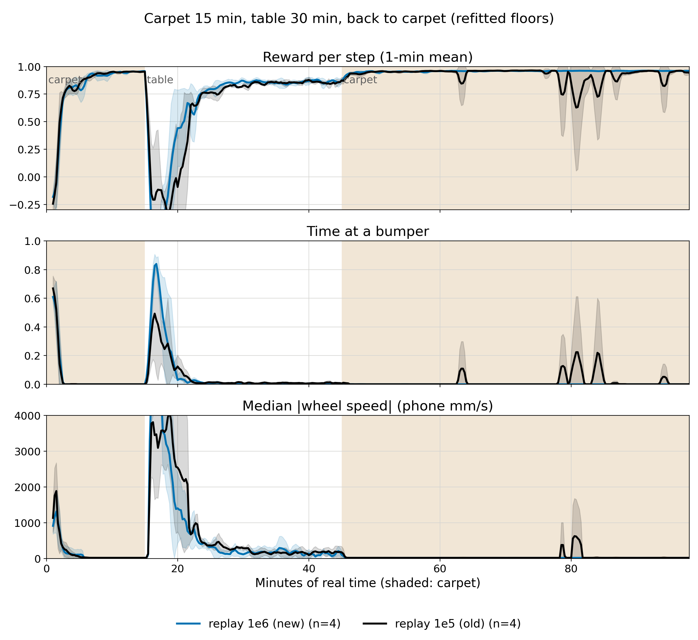

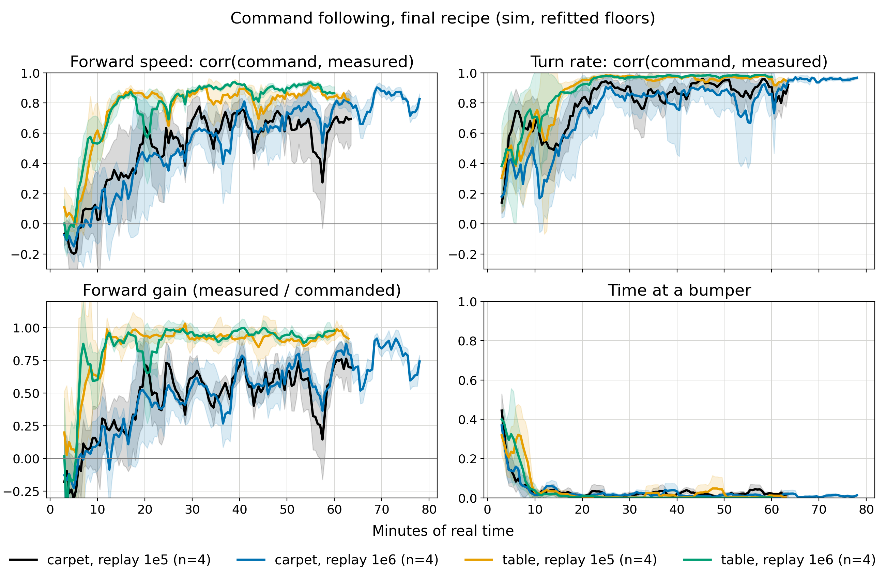

## 7. Faster command learning: relabelling and mirroring (Monday)

`--cmd_relabel F` gives a fraction F of each training batch a fresh command
with its tracking reward recomputed (hindsight relabelling, possible because
the command is exogenous and the reward is a known function of it);
`--cmd_mirror F` swaps left and right in a fraction F (wheels, actions,
turn sign). Both run on the learner (`embodied/envs/robot_relabel.py`).
Minutes to correlation 0.7, final blocks, e2425–e2450/e2463–e2464, 68 min
each; the gain column is the forward gain over the last ~2 min.

| floor, arm | forward | turn | final forward gain |
|---|---|---|---|
| carpet, base | 27.8 ± 5.1 | 9.6 ± 2.8 | 0.52 ± 0.12 |
| carpet, relabel 0.5 | 31.0 ± 7.9 | 11.1 ± 1.7 | 0.68 ± 0.12 |
| carpet, relabel 0.9 | 36.8 ± 3.9 | 7.8 ± 2.0 | 0.72 ± 0.08 |
| carpet, mirror 0.5 | 24.5 ± 7.0 | 11.4 ± 6.9 | 0.51 ± 0.09 |
| carpet, relabel 0.5 + mirror 0.5 | 22.2 ± 4.7 | 12.9 ± 5.7 | 0.72 ± 0.07 |
| table, base | 17.4 ± 3.0 | 10.5 ± 2.9 | 0.96 ± 0.04 |
| table, relabel 0.5 + mirror 0.5 | 12.1 ± 2.5 | 10.1 ± 3.4 | 1.03 ± 0.03 |

n=4 per arm. Relabelling makes the final forward tracking more accurate but
delays it on carpet; mirroring gives the earlier start; together they are
~1.25x (carpet) to ~1.4x (table) faster -- worth using on the robot
(now the `robot_command` default), not the order-of-magnitude gain
asked for. Turning is learnt in ~10 min regardless; forward on carpet is the
bottleneck. P100 seeds (2/3 of the V100's updates) learnt as fast as V100
ones, so more learner compute is not the lever.

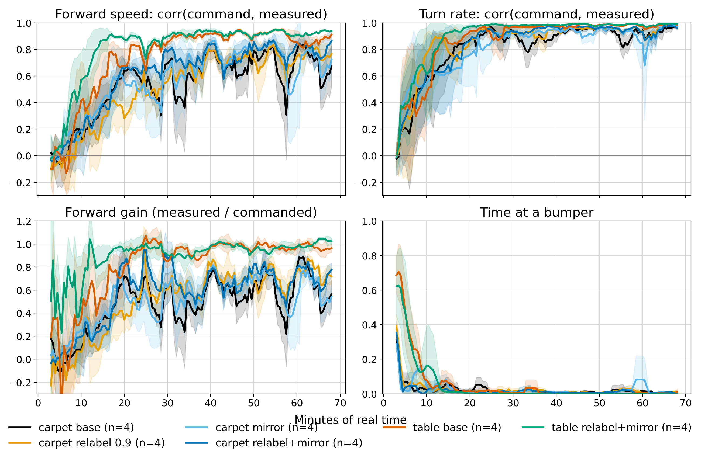

## 8. Sim policies on the robot, and what the sim got wrong (Monday night)

Alex ran two sim balance policies on the robot with training paused:
e2468 (table, final recipe) as e2478 and e2471 (carpet) as e2479 (1.5 and
2.2 min off the bumpers, paused stretches dropped). Both balanced, but far
more restlessly than in the sim (`figs/s2r/closedloop.png`): on the table
the robot drove (median |forward| 387 vs 20 mm/s) and spun one way (mean
turn -246 mm/s); on carpet wheels 52 vs 14 mm/s, tilt rate 4x.

What is **not** wrong: fed the outputs the robot was sent, restarted every
0.3 s from its state, the fitted sim predicts these recordings as well as the
robot-trained runs it was validated on (window error 2.97 table, 1.54 carpet,
against 3.70 / 2.01; `figs/s2r/openloop.png`). Sensor lag (tilt vs tilt rate),
action-to-wheel delay (~19 ms both) and sensor noise also match; the sim's
noise is if anything higher.

What is wrong, found by running the same policy closed loop in the sim with
one thing changed (`tools/robot/dev/sim_closed_loop.py`, `figs/s2r/sweep1.png`):

* **The balance point.** Drawn once per run (+-1 deg), it is learnt by
  heart. Moved 0.25 deg forward, the e2468 policy drives and spins like the
  real table run (|fwd| 390, turn -296 mm/s, tilt -0.95 deg, 4% on a bumper;
  real 387, -246, -0.88, 7.5%); all three seeds go the same way. One wheel
  0.85x, +-0.03 output bias, 2x sensor noise: no effect; +2 ticks delay: small.
* **Gearbox stiction.** Fitted on the stand (wheels in the air) at 0.385 of
  stall. On the floor, under the policy, still wheels break away much more
  often at small outputs:

  | output | 0.15-0.2 | 0.25-0.3 | 0.35-0.4 | 0.4-0.5 |
  |---|---|---|---|---|
  | carpet, robot | 0.09 | 0.14 | 0.38 | 0.47 |
  | carpet, sim | 0.00 | 0.00 | 0.01 | 0.02 |
  | table, robot | 0.37 | 0.49 | 0.58 | 0.58 |
  | table, sim | 0.11 | 0.15 | 0.30 | 0.56 |

  (fraction of still wheels moving within 3 ticks). With 0.385 the sim
  carpet robot stands dead still at any balance point; at 0.2-0.25 it moves
  like the real one. A joint refit including the balancing data gives 0.227.

Fix, now in `robot_sim`: `sim_stick 0.2` and `sim_eq_every 180` (a new balance
point, +-1 deg, every 3 min). In the stick-0.2 sim, with the balance point
moved -1..+1 deg (`figs/s2r/robust_r2.png`, mean over balance points, n=3):

| training | drift (mm/s) | median turn (mm/s) | on a bumper | min to balance (table) |
|---|---|---|---|---|
| stick 0.385, fixed point (old) | 519 ± 48 | 229 ± 16 | 0.10 ± 0.03 | 4.1 ± 0.4 |
| stick 0.2, fixed point | 477 ± 24 | 49 ± 10 | 0.04 ± 0.00 | 4.8 ± 0.6 |
| stick 0.2, redrawn every 60 s | 272 ± 37 | 48 ± 11 | 0.02 ± 0.00 | 9.2 ± 1.5 |
| stick 0.2, redrawn every 180 s | 227 ± 57 | 45 ± 10 | 0.02 ± 0.00 | 6.6 ± 0.8 |

On carpet the redraw costs nothing (2.6 ± 0.1 vs 2.3 ± 0.5 min). None of
the policies is fully still across balance points: the policy has to find
the robot's balance point, and on the table that means some driving.

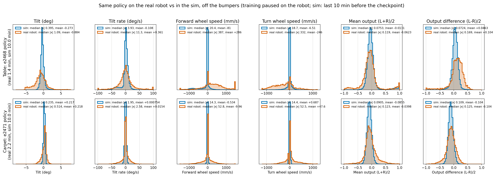
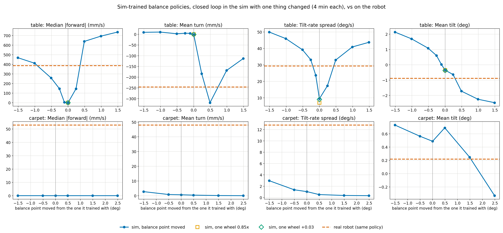
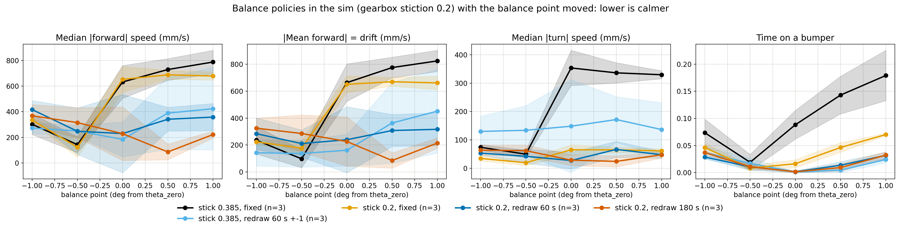

Round 3 (e2603–e2608) trained in the matched sim (`robot_sim` as now:
stick 0.2, balance point redrawn every 180 s). Carpet balance is learnt as
fast as before (e2505–e2510, e2607–e2608: 2.7–3.3 min to score 0.7) and every
carpet policy, from round 2 or 3, stays still at balance points −1…+1° in
the stick-0.2 sim (drift ≤ 6 mm/s, no bumper), except e2505, which collapsed
late (last-5-min score 0.29). Command learning with relabel + mirror is not
hurt (n=2 against n=4): forward correlation 0.7 at 19.5 ± 9.5 vs 11.6 ± 2.5
min on the table, 16.0 ± 2.0 vs 25.5 ± 4.3 min on carpet; final forward
correlation 0.84–0.90.

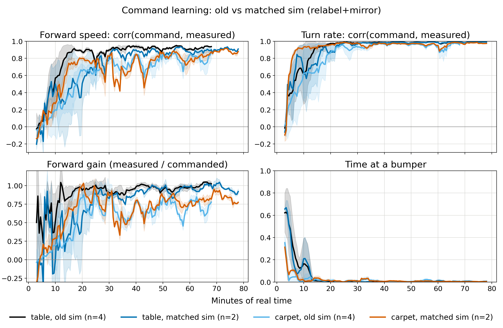

Policies to try on the robot: e2503 (table balance, drift 159 mm/s, the
best of round 2), e2608 (carpet balance), e2604 (table command), e2605
(carpet command).

## 9. Round 3 on the robot: warm-start collapse, and the body's inertia (Wednesday)

The only real recording of a round-3 policy is e2732: e2605 (carpet command)
warm-started on the carpet with the learner on (`from_sim.sh train`), 11 min.
Saved policies played from the Dreamer Player or the dashboard menu are not
recorded anywhere: to measure a sim policy, use `from_sim.sh train` and keep
training paused on the dashboard, as for e2478/e2479.

**The policy transferred; the fine-tuning broke it.** The first episode (20 s,
before any update) is the sim policy alone: forward tracking correlation 0.71
(sim 0.84 at balance points −1…+1°), turn 0.68 (sim 0.99), tilt rate SD 18
deg/s (sim 14–16). After the first update it sat on a bumper half of the next
episode (forward 0.18) and took ~5 min to track again. The sim world model fit
the real data as well as the sim's at first (dyn loss 1.54 against 1.56,
reward 0.59 against 0.56). But the learner then trained 178k samples on the
first 536 real steps (prefill is one batch, `online.py:660`, at train_ratio
8192), and dyn loss rose to 2.5. A warm start needs a longer prefill or a
lower train ratio at first.

**What the sim got wrong: the body tips too easily under drive.** Open loop
(0.3 s windows, the fitted sim fed the outputs the robot was sent), the sim
is right at small outputs but its body tips back 2.5–3° where the real one
tips ≤0.5° once the output is above ~0.35 (`realcmd/s2r/r3_openloop.py`). Its
wheels run ahead too. The same holds for e2479 and for e2060, which was
trained on the robot, so it is the model, not this policy. It is not output
chatter, the bumpers, the delay, carpet drag, a motor current limit or the
CoM height (scanned). The body's pitch inertia is (CAD 0.648 g m², never
fitted: the stand fixes only the motor's torque-to-armature ratio):

| sim | held-out carpet | held-out table | train carpet | train table | stand |
|---|---|---|---|---|---|
| robot_sim (round 3) | 2.12 | 3.76 | 2.25 | 3.10 | 0.72 |
| inertia 3x | 1.76 | 3.41 | 1.99 | 2.73 | 0.72 |
| **inertia 4x** | **1.71** | **3.35** | 2.03 | 2.72 | 0.72 |
| inertia 4x, sliding friction 2x | 1.80 | 3.63 | 2.08 | 2.78 | 2.46 |

(held out: e2060, e2061 and the second half of e2732; train: the probe's
bumper tests, e2478/e2479 and the first half of e2732.) A global refit
(DE) with inertia free did not move from fit7 in 2000 evaluations, nor did
adding e2732 to fit7's data (held-out 2.153 / 3.872 either way).
Turning matches open loop (turn speed after 0.3 s within ~5–10%).

`robot_sim` now sets `env.robot.sim_inertia: 4`. Closed loop, e2605 in the 4x
sim tracks forward at 0.57–0.64 (0.77–0.84 in its own sim; robot 0.71 over one
episode). Round 4 (e2990–e2995) trained in it, against round 3 where its runs
are still on /work (minutes of sim time to a 5-episode mean of 0.7/step; mean
over the last 10 min):

| task | round 3 (inertia 1) | round 4 (inertia 4) |
|---|---|---|
| carpet balance | e2608: 2.7 min, 0.96 | e2994: 3.3 min, 0.95 |
| table balance | e2503 (round 2): 9.0 min, 0.84 | e2995: 8.3 min, 0.84 |
| carpet command | e2605: 9.3 min, 0.83 | e2992: 24.4, 0.78; e2993: 9.7, 0.74 |
| table command | e2604: 15.7 min, 0.82 | e2990: 26.7, 0.80; e2991: 16.0, 0.77 |

Balance is learnt as fast. Command following is a little slower and ends a
little lower (n=2 against n=1). Policies to try: e2994 (carpet balance),
e2995 (table balance), e2992 (carpet command), e2990 (table command).

**On the robot, table (recorded by the phone, no trainer, most likely
action):** e2995 (round 4) against e2503 (round 2), 4.8 and 3.4 min:
reward 0.83–0.92 against 0.76–0.82 per minute, median forward speed 0–44
against 177–223 mm/s, tilt SD 0.6–1.0° against 1.1–1.3°, tilt-rate SD 11–21
against 19–26 deg/s, on a bumper 0–1% against 2–3%. The round-4 policy stands
almost still, better than in its own sim (0.84). Warm-started with the learner
on (e2996), the same policy fell apart within a minute, as e2605 did in e2732.

## 10. Gearbox backlash, and round 5 (Wednesday night)

On carpet, e2992 tracked steady forward commands but on back (and often
forward) commands it fell into a bang-bang limit cycle: output flipping
between -1 and +1, body swinging -6..+8 deg, rate SD 58.7 deg/s, forward
tracking 0.16. Its own sim (inertia 4) gave rate SD 12 and tracking 0.69.

ARX regressions on the command recording: the encoders answer an output
change after one tick at every amplitude, as in the sim, but the body's tilt
answers one tick later, barely at all to small chatter and 2-3x harder to big
reversals. That is play in the gearbox: the rotor crosses the gap freely, then
engages with a kick. Inertia 4 was mostly standing in for the delay.

The model (`robot_mujoco.py`, `sim_backlash`, `sim_gear_k`) now has a rotor
joint per wheel carrying the armature and driven by the actuator, coupled to
the wheel through a dead-zone spring (gap +-backlash, stiffness gear_k,
near-critical damping); the encoders read the rotor. Also new: `sim_tilt_lag`
and `sim_rand` (e.g. `inertia:1:4,backlash:0:0.05`, redrawn every
`sim_rand_every` s). `sysid_fit.py` fits backlash, gear_k, tilt_lag and floor
friction.

Single changes that did not explain the command data: inertia 1/2, delay, CoM
height, stall/armature x2, wheel top speed, floor slip, tilt lag. The 0.3 s
open-loop fit still prefers inertia 4 without backlash (total 2.17 vs 2.41,
mostly on balancing data; in-air 0.85 vs 1.33), but closed loop decides it:
with backlash 0.03 rad and the CAD inertia, the sim reproduces e2992's
failure (rate SD 58.5, tracking 0.29) and e2605's calm on the robot (24 /
0.69 vs 18 / 0.71). The inertia-4 sim calls both calm.

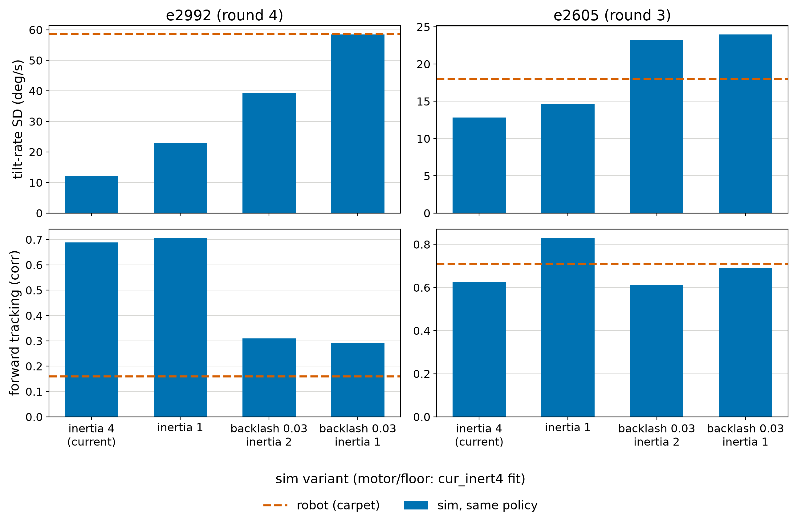

Round 5 (2 h each, p100) trains through both models: e6030/e6031 carpet with
inertia 1-4 and backlash 0-0.05 redrawn every 60 s, e6032 carpet with fixed
backlash 0.03 and inertia 1, e6033 table randomized like e6030. Final
checkpoints (eval mode, 4 min per variant): all four keep tracking in the
backlash sims where e2992 collapses. e6031 is the best carpet policy (rate SD
21-23, forward tracking 0.71-0.72 in all three sims). e6032 led at 1 h
(SD 19, tracking 0.71) but its final checkpoint dropped to 0.36-0.55, so
single 4-min evals are noisy. e6033 (table) tracks 0.63-0.67 with SD about 40.
Runs archived to the bucket.

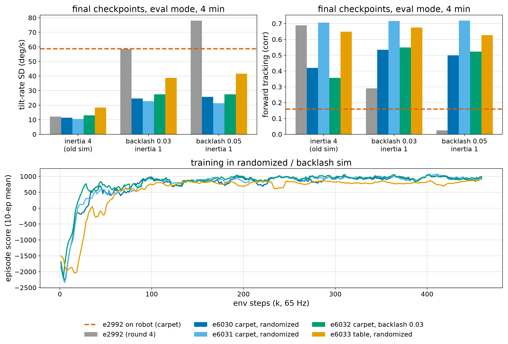

All of this is on the robot branch (merged from `sim-backlash-r5`).

## 11. Round 5 on the robot, closed-loop sysid, and round 6 (Friday-Monday)

### 11.1 Round 5 on the robot (Friday 2026-10-30, Alex)

Played from the phone in eval mode, no trainer: e6031 on carpet with long
hard forward/back stick, e6033 on the table (recordings in
`sysid/recordings/r5_robot_20261030/`). Verified against the CSVs
(`r6/realstats.py`; `r6/` here is `tools/robot/dev/r6/`):

| | e6031 carpet | e6033 table |
|---|---|---|
| forward tracking (corr) | 0.55 (e2992: 0.06) | 0.84 |
| tilt-rate SD (deg/s) | 41.5 (e2992: 58.8) | 37.8 |
| falls below -6 deg / min | 18.8 | 39.0 |
| tilt, stick forward: median / p95 | +4.6 / +7.5 | -1.0 / +2.1 |
| speed, stick forward / back (mm/s) | 537 / -992 | 1532 / -665 |

The balance policies of 10-28 were calm on the same floors (rate SD 6.7-24,
balance point +0.2 deg). Alex measured the real bumper contact angles:
carpet +7.8 / -6.2 deg, table about +9 / -7. The sim used +9.2 / -6.9 on
both, so on carpet the policy could lean to 7.7 deg free of penalty, which is
where the real robot touches. Driving forward on carpet, the front scrapes.

### 11.2 Closed-loop system identification

Instead of the 0.3 s open-loop windows, the sim is now judged by what the
seven policies that have been recorded on the robot do in it
(`r6/sweep.py`, `r6/loss.py`; `tools/robot/dev/sim_closed_loop.py
--commands REC.csv` replays a recording's stick). Each policy runs 3.5 min
in eval mode at the robot's balance point (+0.2 deg), with the measured
bumper angles, and is scored against its recording on tilt-rate SD, forward
tracking, saturation, falls and the tilt and speed quantiles per stick
direction (forward / zero / back). Policies: balance e2994, e2608 (carpet),
e2995, e2503 (table); command e2992, e6031 (carpet), e6033 (table).

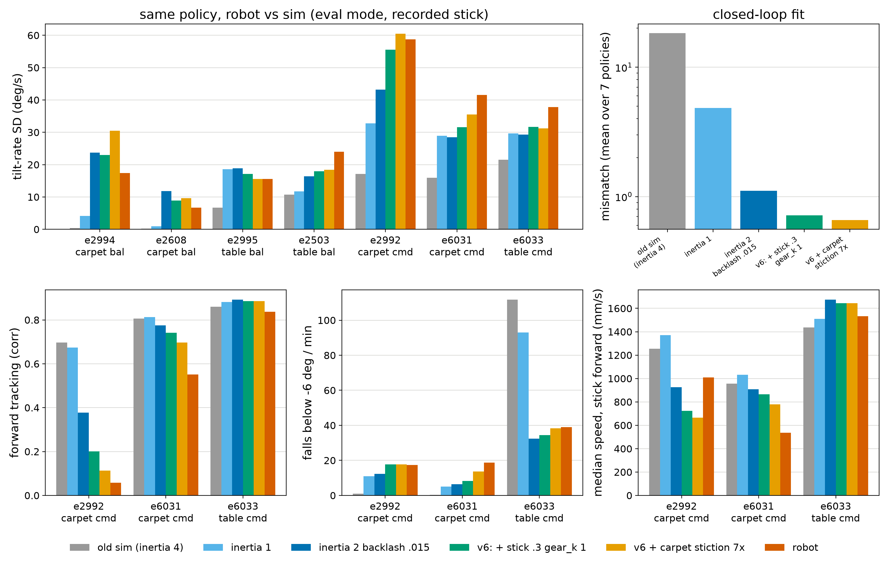

- The production sim (inertia 4, no backlash) fits worst (mismatch 18): the
  balance policies stand dead still in it (rate SD 0.3-7) where on the robot
  they wobble at 7-24 deg/s, and the command policies are 2-4x calmer than on
  the robot.
- Gearbox play is what makes them wobble: inertia 2 with backlash 0.015 rad
  fits all seven (1.11). It is not round 5's 0.03 at inertia 1: that made
  the table balance policy e2995 oscillate at 89 deg/s (robot 15.6).
- Sweeps A-E (about 50 variants; noise between repeats ~0.1 on the mean):
  gearbox stiction 0.3 of stall (was 0.2) and a softer mesh (gear_k 1, was 2)
  bring it to 0.72 ("v6"); carpet rolling stiction 7x rolling (was 4.5) to
  0.66. v6 reproduces e2992's carpet failure (rate SD 59 vs 58.8, tracking
  0.18 vs 0.06) and e6033's falls (38 vs 39 / min).
- Wrong directions: an extra tick of delay (e2995 loss 11), weaker motors
  (calmer, not wilder), tilt lag, sensor noise x2 (neutral).
- Still off: e6031 is calmer and tracks better in v6 (36 / 0.67) than on the
  robot (41.5 / 0.55), and the robot leans +2.8 deg at zero stick on carpet
  where the sim leans -2.
- Carpet scrape (`sim_scrape`, a drag at the front bumper rising from 4 deg
  to the bumper) brings the forward speed at the same lean toward the
  robot's (e6031 at +4.6 deg: robot 537, sim 865 -> 610 with 20 N s/m) but
  did not lower the overall mismatch; it is kept in the training randomisation.
- The wheel speeds the phone reports are encoder ticks per step (~90 mm/s
  each; 87% of a balance run reads exactly 0). `sim_enc_q 1.385` models it;
  the recorded policies are indifferent to it (0.72 -> 0.72).

New sim keys: `sim_scrape`, `sim_scrape_from`, `sim_enc_q`; `sim_rand` also
takes `stick`, `gear_k`, `stall`, `rstatic`, `scrape`.

- Sweep E (around v6): gearbox stick 0.4 fits the balance policies better
  (loss 0.48 vs 0.66) but e6031 worse; gear_k 0.7 and tilt lag 8 ms worse;
  inertia 2.5, backlash 0.02, noise 0.5 within noise. Training randomises
  stick 0.2-0.45, inertia 1.5-2.5, backlash 0.01-0.02, gear_k 0.8-2,
  carpet rolling stiction 5-9x, scrape 0-40, motor strength 0.85-1.1x.

### 11.3 Training round 6

Every policy is scored the same way (`r6/evalpol.py`, `r6/evsum.py`): 3.5 min
in v6 replaying Alex's 10-30 stick for that floor ("fit"), and in nine
harder variants (no/more scrape, stiction 10x, inertia 3 with backlash 0.025,
balance point +-1 deg, gear_k 3, noise x2, one tick more delay, and carpet
for table policies), reporting the mean and the worst ("min") tracking
correlation. Reference: e6031 on carpet scores fit corr 0.66, rate SD 31,
14 falls/min; e6033 on the table 0.89 / 32 / 34.

New training keys: `env.robot.tilt_penalty` (bumper_track pays minus
w * (tilt / that side's bumper)^2), `env.robot.action_rate_quad` (squared
action change), `agent.imag_loss.smooth` (CAPS-style temporal smoothness
on the actor's mean action in imagination, flat agent only).

Round 6a (carpet, e8100-e8107, 2 h, one seed per arm), fit corr / rate SD / falls per min:

| arm | corr | rate SD | falls |
|---|---|---|---|
| base (old rand, carpet bumpers) | 0.59 | 33 | 3.0 |
| tilt 0.5 | 0.54 | 42 | 7.7 |
| tilt 0.5 + quad 0.5 | 0.38 | 47 | 14 |
| tilt 0.5 + smooth 0.3 | 0.30 | 20 | 5.0 |
| tilt 0.5 + smooth 1.0 | 0.24 | 17 | 1.7 |
| tilt 0.5 + quad 0.5 + smooth 0.3 | 0.59 | 18 | 2.3 |
| tilt 0.5 + minstd 0.05 | 0.38 | 31 | 0.3 |
| tilt 1 + quad 1 + smooth 0.3 | 0.52 | 14 | 0.3 |

The smoothness arms are calm but the strongest ones no longer drive forward
or back at all (their correlation comes from turning). None tracks better
than e6031.

Round 6b (randomised around v6, tilt 0.5; "SM" = quad 0.5 + smooth 0.3, n=2):

| floor, arm | eval floor | corr | rate SD | falls |
|---|---|---|---|---|
| table, plain (n=1) | table | 0.84 | 42 | 22 |
| table, SM | table | 0.84 ± 0.00 | 17 ± 1 | 3.3 ± 2.8 |
| mixed, SM | table | 0.76 ± 0.05 | 16 ± 0 | 0.3 ± 0.0 |
| carpet, plain (n=1) | carpet | 0.28 | 27 | 1.3 |
| carpet, SM | carpet | 0.20 ± 0.27 | 12 ± 4 | 0.2 ± 0.2 |
| mixed, SM | carpet | 0.47 ± 0.08 | 17 ± 1 | 0.4 ± 0.5 |

On the table, SM keeps e6033's tracking with half the wobble and a tenth of
the falls. On carpet no new policy drives forward (forward tilt p95 below
4 deg, speed ~0) while e6031 in the same sim does (589 mm/s, robot 537), so
the cause is the reward, not the physics: at full stick 2500 mm/s a carpet
speed of 600 earns exp(-(0.76/0.4)^2) = 0.03, less than the tilt penalty
for leaning. Round 6c lowers full stick to 1500 mm/s; round 6d adds
`env.robot.track_progress` (w * |c| * clip(v / c, 0, 1): linear pay for
moving toward the commanded forward speed).

Round 6c (carpet, full stick 1500 mm/s, sweep-E randomisation, tilt 0.5 unless noted; 3 h; n=2 unless noted):

| arm | fit corr | rate SD | falls/min | worst-variant corr |
|---|---|---|---|---|
| e6031 (reference) | 0.66 | 31 | 14 | 0.22 |
| base | 0.78 ± 0.02 | 22 ± 3 | 0.2 ± 0.2 | 0.56 ± 0.03 |
| quad 0.5 | 0.79 ± 0.01 | 22 ± 1 | 0.0 ± 0.0 | 0.55 ± 0.03 |
| sigma 0.6, tilt 0.25 | 0.83 ± 0.08 | 14 ± 1 | 0.0 ± 0.0 | 0.65 ± 0.25 |
| minstd 0.05 (n=1) | 0.82 | 16 | 0.0 | 0.64 |
| tilt 0 (n=1) | 0.65 | 28 | 0.3 | 0.46 |

Lowering full stick to 1500 mm/s is what made carpet forward work: every
run drives forward at 450-630 mm/s (the robot's e6031: 537), and every arm
beats e6031 on tracking, wobble and falls. A wider kernel with a smaller
tilt penalty is calmest; dropping the tilt penalty makes it wobblier.
Carpet policies do not transfer to the table: on its low friction they run
away (several m/s, 35-490 falls per minute), so a carpet policy is for
carpet only.

Round 6d adds the progress term (`track_progress` 0.5) to SM (quad 0.5 +
smooth 0.3) with tilt 0.5 and the sweep-E randomisation (3 h):

| floor, arm | eval floor | fit corr | rate SD | falls/min | worst-variant corr |
|---|---|---|---|---|---|
| carpet, full stick 1500 (n=2) | carpet | 0.89 ± 0.05 | 10 ± 1 | 0.0 ± 0.0 | 0.73 ± 0.10 |
| carpet, progress 1.0 (n=1) | carpet | 0.90 | 11 | 0.3 | 0.71 |
| carpet, no SM (n=1) | carpet | 0.80 | 22 | 0.7 | 0.58 |
| mixed, full stick 1500 (n=2) | carpet | 0.72 ± 0.10 | 18 ± 4 | 0.5 ± 0.3 | 0.60 ± 0.14 |
| mixed, full stick 1500 (n=2) | table | 0.73 ± 0.04 | 19 ± 2 | 0.7 ± 0.9 | 0.64 ± 0.09 |
| mixed, full stick 2500 (n=2) | carpet | 0.79 ± 0.01 | 16 ± 3 | 0.2 ± 0.2 | 0.62 ± 0.05 |
| mixed, full stick 2500 (n=2) | table | 0.86 ± 0.01 | 16 ± 0 | 0.0 ± 0.0 | 0.74 ± 0.01 |

With the progress term, smoothing no longer stops the robot from driving:
the carpet SM runs are the best carpet policies so far (wobble a third of
e6031's, no falls). The mixed-floor policies at full stick 2500 track
on both floors (table as well as e6033, with half its wobble and no
falls; carpet better than e6031); at 1500 they drive the table too slowly.

Round 6e (full stick 1500, sigma 0.6, tilt 0.25, quad 0.5, no CAPS, no progress; 4 h)
and 6f (mixed only, same reward, floors switching every 2 min instead of 10; 3 h):

| arm | eval floor | fit corr | rate SD | falls/min | worst-variant corr |
|---|---|---|---|---|---|
| 6e carpet (n=3) | carpet | 0.73 ± 0.20 | 21 ± 8 | 0.4 ± 0.6 | 0.47 ± 0.41 |
| 6e table (n=2) | table | 0.74 ± 0.01 | 26 ± 2 | 3.7 ± 0.6 | 0.32 ± 0.01 |
| 6e mixed (n=3) | carpet | 0.83 ± 0.02 | 18 ± 1 | 0.0 ± 0.0 | 0.70 ± 0.07 |
| 6e mixed (n=3) | table | 0.76 ± 0.01 | 26 ± 1 | 2.0 ± 0.9 | 0.68 ± 0.01 |
| 6f 2-min, quad (n=2) | carpet | 0.67 ± 0.01 | 23 ± 2 | 0.5 ± 0.2 | 0.52 ± 0.01 |
| 6f 2-min, quad (n=2) | table | 0.64 ± 0.03 | 31 ± 2 | 2.0 ± 1.3 | 0.51 ± 0.08 |
| 6f 2-min, no quad (n=2) | carpet | 0.65 ± 0.01 | 28 ± 0 | 0.2 ± 0.2 | 0.46 ± 0.02 |
| 6f 2-min, no quad (n=2) | table | 0.65 ± 0.00 | 37 ± 2 | 2.7 ± 1.0 | 0.52 ± 0.01 |
| 6f 2-min, quad + progress (n=2) | carpet | 0.84 ± 0.06 | 18 ± 4 | 1.0 ± 0.7 | 0.56 ± 0.25 |
| 6f 2-min, quad + progress (n=2) | table | 0.73 ± 0.02 | 28 ± 2 | 0.7 ± 0.0 | 0.56 ± 0.11 |

One 6e carpet seed (e8141) collapsed in its last 1.5 h (fit corr 0.89 at
2.4 h, 0.45 at 4 h), so final policies are picked by evaluating several of
the last saved checkpoints (`ckpt_milestones`, every 19.5k steps), not just
the last. Without CAPS the table policies wobble about 26 deg/s against 16
for the 6d mixed recipe, and switching floors every 2 min instead of 10 does
not help.

Checkpoint choice. Neighbouring checkpoints of one run (39k steps apart)
can differ a lot (e8136 on carpet: 0.50 and 0.49 fit corr with 12 and 41
falls/min at 527k and 566k steps, 0.85 at 644k), and repeat evaluations of
the same checkpoint differ by about 0.05 corr. Averaging the weights of the
last 3-5 checkpoints (SWA) made every policy much worse (e8136: 82 falls/min
on carpet), so policies are chosen as single checkpoints from a sweep over
the last five (`r6/ckptsweep.sh`).

Round 6h (mixed, 6d recipe with one change each; p100, 3 h, n=2):

| arm, eval floor | fit corr | rate SD | falls/min | worst-variant corr |
|---|---|---|---|---|
| 6d recipe, carpet | 0.79 ± 0.01 | 16 ± 2 | 0.2 ± 0.2 | 0.61 ± 0.04 |
| balance point ±2 deg, carpet | 0.64 ± 0.17 | 15 ± 1 | 0.2 ± 0.2 | 0.40 ± 0.20 |
| dynamics redrawn every 20 s, carpet (n=1) | 0.70 | 15 | 0.7 | 0.50 |
| CAPS 0.6, carpet | 0.60 ± 0.02 | 16 ± 2 | 0.3 ± 0.3 | 0.34 ± 0.04 |
| progress 1.0, carpet | 0.76 ± 0.03 | 19 ± 0 | 0.2 ± 0.2 | 0.63 ± 0.03 |
| 6d recipe, table | 0.86 ± 0.00 | 16 ± 0 | 0.0 ± 0.0 | 0.74 ± 0.01 |
| balance point ±2 deg, table | 0.76 ± 0.05 | 17 ± 1 | 0.0 ± 0.0 | 0.57 ± 0.10 |
| dynamics redrawn every 20 s, table (n=1) | 0.83 | 17 | 0.7 | 0.60 |
| CAPS 0.6, table | 0.81 ± 0.02 | 15 ± 0 | 0.3 ± 0.3 | 0.56 ± 0.01 |
| progress 1.0, table | 0.66 ± 0.08 | 16 ± 2 | 3.7 ± 3.7 | 0.52 ± 0.19 |

None of the four changes beats the 6d recipe. The second 20-s seed (e8173)
collapsed into running away on both floors (22 and 830 falls/min), so it is
left out of those rows. CAPS 0.6 again suppresses reversing (back speed
100-250 mm/s against ~700). A wider balance-point range (the robot leaned
+2.8 deg at zero stick on carpet) does not help in sim; the robustness set
already tests ±1 deg.

Round 6g (6d reward = SM + progress 0.5; v100, 4 h ≈ 0.92M steps):

| arm, eval floor | fit corr | rate SD | falls/min | worst-variant corr |
|---|---|---|---|---|
| mixed, full stick 2500, tilt 0.5 (6d recipe), carpet (n=3) | 0.66 ± 0.05 | 18 ± 2 | 0.0 ± 0.0 | 0.51 ± 0.02 |
| mixed, 2500, sigma 0.6, tilt 0.25, carpet | 0.86 ± 0.01 | 12 ± 1 | 0.0 ± 0.0 | 0.68 ± 0.04 |
| carpet, full stick 1500 (n=1) | 0.92 | 10 | 0.0 | 0.80 |
| mixed, 6d recipe, table (n=3) | 0.87 ± 0.02 | 15 ± 0 | 1.8 ± 1.9 | 0.65 ± 0.03 |
| mixed, 2500, sigma 0.6, tilt 0.25, table | 0.83 ± 0.01 | 15 ± 1 | 0.5 ± 0.5 | 0.79 ± 0.00 |
| table, full stick 2500 | 0.86 ± 0.01 | 18 ± 0 | 1.5 ± 1.2 | 0.14 ± 0.00 |

The carpet recipe replicates (e8167 matches e8132). Three more seeds of the 6d
mixed recipe are weaker on carpet than e8136/7 were (0.66 against 0.79), so
that recipe is seed-sensitive on carpet. The wider kernel with half the tilt
penalty is the most even mixed-floor recipe: 0.83-0.86 on both floors, no
falls on carpet, and the best worst-variant scores (0.68 carpet, 0.79 table).
Table-only policies have a worst variant of 0.14: that variant is carpet,
which they cannot drive on.

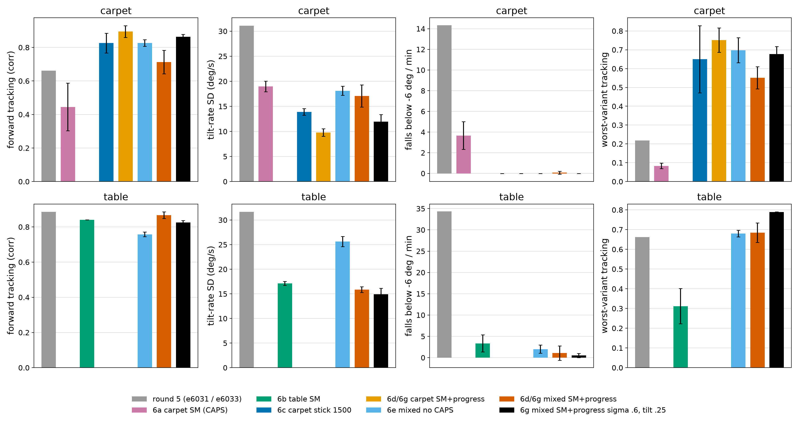

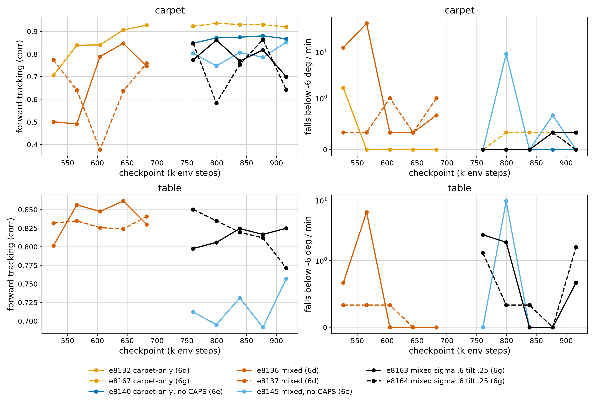

Carpet-only runs are steady across their last checkpoints (e8167: 0.92-0.94
at all five, at most 0.3 falls/min); mixed-floor runs swing by up to 0.3 in
carpet tracking from one checkpoint to the next while staying steady on the
table. The swings do not follow which floor the run was on when the
checkpoint was saved (carpet-phase vs table-phase checkpoints: e8163 0.84 vs
0.75, e8164 0.72 vs 0.75, e8136 and e8137 equal).

Round 6i (mixed 6d recipe, p100, 4 h ≈ 0.92M steps, n=2): is the swing
between checkpoints a learning-rate effect? Each run is scored at its last
five checkpoints (every 39k steps); the table gives the mean over those five
and, as "swing", the SD across them, each averaged over the two seeds
(`r6/ckptstats.py`).

| arm | carpet corr | carpet swing | table corr | table swing |
|---|---|---|---|---|
| 6d recipe (lr 3e-4) | 0.64 ± 0.04 | 0.16 | 0.81 ± 0.03 | 0.03 |
| actor lr 1e-4 | 0.66 ± 0.03 | 0.07 | 0.84 ± 0.01 | 0.04 |
| world-model and actor lr 1e-4 | 0.68 ± 0.08 | 0.05 | 0.81 ± 0.02 | 0.02 |
| tilt-sensor lag randomised 0-15 ms | 0.76 ± 0.04 | 0.07 | 0.84 ± 0.01 | 0.02 |

A lower learning rate halves to thirds the swing on carpet but does not
raise the level. Randomising the tilt lag (`sim_rand ...,tilt_lag:0:0.015`)
gives the best carpet tracking of the round and the best worst-variant
scores (0.58 and 0.66 against 0.34-0.50), at no cost on the table.

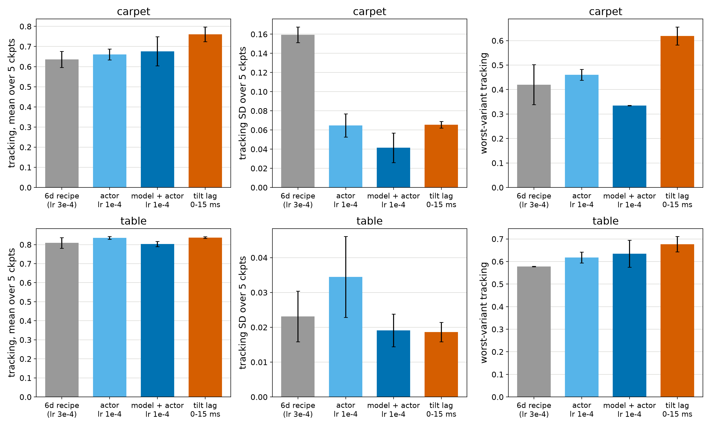

Round 6j/6k (v100, 6 h ≈ 1.38M steps): does longer training settle the
mixed policies? Same scoring (last five checkpoints, every 39k steps).

| arm | n | carpet corr | carpet swing | table corr | table swing |
|---|---|---|---|---|---|
| carpet only (e8132 recipe) | 2 | 0.89 ± 0.05 | 0.06 | | |
| mixed 6d recipe, actor lr 1e-4 | 2 | 0.79 ± 0.04 | 0.08 | 0.74 ± 0.05 | 0.10 |
| mixed sigma 0.6, tilt 0.25 (6g best) | 3 | 0.71 ± 0.04 | 0.16 | 0.83 ± 0.01 | 0.03 |
| table only (6g recipe) | 1 | | | 0.72 | 0.20 |

Six hours do not help the mixed policies: carpet tracking and its swing are
the same as at 4 h (e8163/4), and on the table the 6 h checkpoints fall more
often (1-11 falls/min against 0-1). Carpet-only training stays stable at any
length (e8194: 0.94 at all five checkpoints, worst variant 0.80, same as
e8167). The picks in 11.4 stay the 4 h runs.

Round 6l (6g mixed recipe, p100, 4 h, n=2 per arm): the spatial term of
CAPS (Mysore et al. 2021), new in `agent.imag_loss.spatial`. In imagination
the actor is run a second time on a feature with Gaussian noise added to the
deterministic state (`spatial_sigma` times its batch SD), and the squared
difference of the two action means is penalised. It asks for a policy that
does not change its action for small changes in its belief, the part of CAPS
that Mysore et al. found mattered most on hardware. Scored as above (falls
per minute averaged over the five checkpoints).

| arm | carpet corr | swing | falls/min | table corr | swing | falls/min |
|---|---|---|---|---|---|---|
| control | 0.78 ± 0.02 | 0.11 | 4.5 | 0.84 ± 0.02 | 0.03 | 1.8 |
| spatial 0.3, noise 0.1 | 0.75 ± 0.00 | 0.09 | 2.8 | 0.84 ± 0.01 | 0.02 | 1.0 |
| spatial 1.0, noise 0.1 | 0.77 ± 0.01 | 0.08 | 0.2 | 0.81 ± 0.00 | 0.02 | 0.6 |
| spatial 0.3, noise 0.3 | 0.79 ± 0.01 | 0.05 | 0.2 | 0.83 ± 0.01 | 0.01 | 0.1 |

The spatial term does not raise tracking, but with noise 0.3 it cuts falls
on carpet about twentyfold and halves the swing between checkpoints; it is
the first change that makes a mixed policy about as steady across checkpoints
as a carpet-only one. Ten-minute evaluations of the best checkpoints are in
11.4; e8217 @799500 (spatial 0.3, noise 0.3) replaces e8164 as the mixed pick.

Round 6m (running, ends ~14:00): the lag randomisation on the 6g mixed recipe
(sigma 0.6, tilt 0.25), alone and with actor lr 1e-4, and on the carpet recipe.
Round 6n (running, ends ~16:20): the same three arms with the spatial term
(0.3, noise 0.3).

### 11.4 Picks for the robot

Ten-minute evaluations (fit sim plus the nine variants, Alex's 10-30 stick,
single checkpoints chosen by the sweeps):

| policy | floor | fit corr | rate SD | falls/min | worst-variant corr | fwd / back speed (mm/s) |
|---|---|---|---|---|---|---|
| e6031 (round 5) | carpet | 0.66 | 31 | 12.7 | 0.17 | 568 / -1105 |
| **e8167 @916500** (carpet-only) | carpet | 0.93 | 9.2 | 0.0 | 0.83 | 648 / -673 |
| e8132 @643500 (carpet-only) | carpet | 0.90 | 9.8 | 0.1 | 0.74 | 706 / -624 |
| **e8217 @799500** (mixed, spatial) | carpet | 0.85 | 11.9 | 0.1 | 0.70 | 803 / -834 |
| e8214 @799500 (mixed, spatial) | carpet | 0.87 | 11.6 | 0.2 | 0.77 | 974 / -780 |
| e8164 @877500 (mixed) | carpet | 0.86 | 9.2 | 0.1 | 0.61 | 648 / -912 |
| e8136 @643500 (mixed) | carpet | 0.83 | 12.9 | 0.1 | 0.66 | 710 / -888 |
| e6033 (round 5) | table | 0.88 | 32.7 | 35.9 | 0.65 | 1668 / -858 |
| **e8217 @799500** (mixed, spatial) | table | 0.85 | 16.1 | 0.0 | 0.77 | 1623 / -1222 |
| e8214 @799500 (mixed, spatial) | table | 0.82 | 15.3 | 0.9 | 0.79 | 1482 / -1072 |
| e8164 @877500 (mixed) | table | 0.82 | 14.9 | 0.5 | 0.74 | 1650 / -1194 |
| e8136 @643500 (mixed) | table | 0.86 | 15.9 | 0.4 | 0.76 | 1626 / -1491 |

In the sim, against round 5: tracking on carpet up from 0.66 to 0.93, wobble
down from 31 to 9 deg/s, falls from 13 to 0 per minute; on the table the
same tracking with half the wobble and almost no falls. The mixed policies
drive both floors; a carpet-only policy runs away on the table.

## Bugs found on the way

- `embodied/core/selectors.py`: `Recency` sampled `len(segment)` (undefined
  at the tree's first level) and `Mixture` had no `len`, so any
  `replay.fracs.recency > 0` run under online learning lost its learner at
  startup while the actor kept acting on the initial policy (5eeb3b1).
- The online learner now writes milestone snapshots (`run.save_every_steps`,
  every 5 min in `robot_sim`) for videos; first keyed on the learner's step
  (trained samples), it wrote ~1 GB/min per run before it was caught (fixed
  c01cfc3, the excess deleted).
- `short-a100` preempts and requeues: a few runs restarted from scratch; the
  plots take the last directory of each experiment number.
